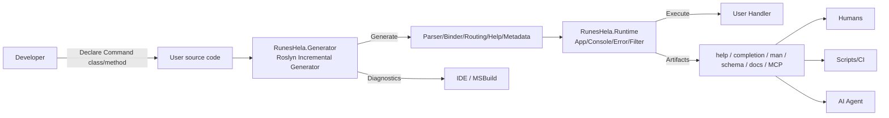
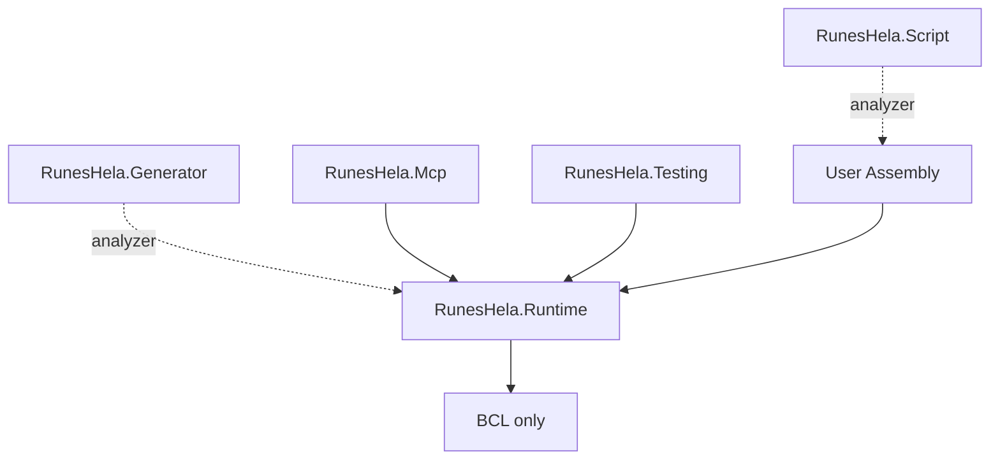
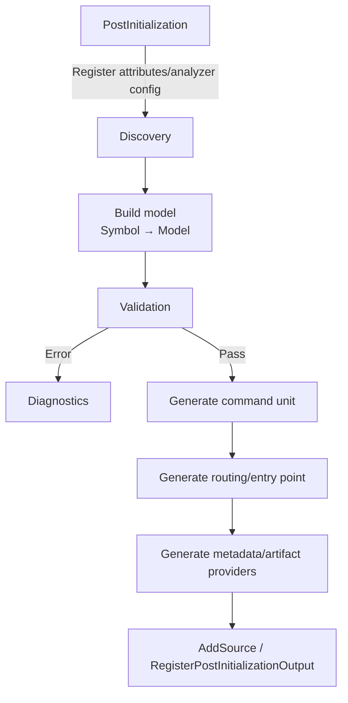
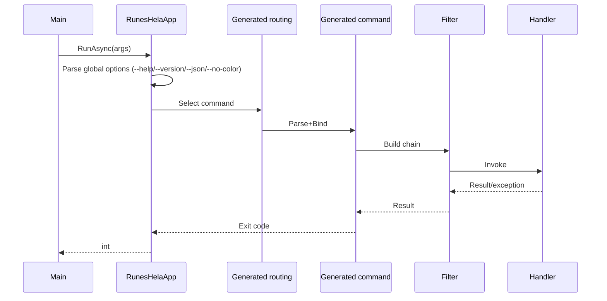

# 02 Technical Design

> Project name: **RunesHela** (finalized, 2026-11-26)
> Version: v0.1 (design baseline, pending decisions)
> Related: [00 Research](./00-research-and-opportunity.md) · [01 PRD](./01-product-requirements.md) · [03 Tasks](./03-implementation-plan.md) · [04 Checklist](./04-acceptance-checklist.md) · [05 ADR](./05-architecture-decisions.md) · [06 Decision Log](./06-decisions.md)

---

## 1. Document Purpose and Scope

This document defines the **implementable technical design** of RunesHela: package layout, compile-time model, generator pipeline, runtime, type system, Agent contract, artifact generation, performance engineering, AOT strategy, diagnostics, testing, security, and versioning strategy.

This document does not include:
- Concrete code implementation (per the user's request, no code is written before development).
- Rationale for naming/licensing/MVP decisions (see 06 Decision Log).
- Marketing and pricing.

---

## 2. Design Principles

| # | Principle | Technical meaning | Counter-example |
|---|---|---|---|
| P1 | **Compile-time first** | Anything determinable at generation time (names, types, default values, help, candidate sets) must not be deferred to runtime | Runtime reflection scanning of commands |
| P2 | **Single-pass parsing** | Arguments are scanned once from left to right; no backtracking, no multi-round matching | Complex grammar that requires multiple traversals |
| P3 | **Zero reflection** | No calls to `Type.GetType` / `Activator` / `MethodInfo.Invoke` / `Expression.Compile` | Constructing command objects at runtime |
| P4 | **Zero third-party dependencies** | The runtime depends only on the BCL; optional integrations are added explicitly by the user | Pulling in a whole dependency tree for logging/configuration |
| P5 | **Single source of truth** | All artifacts derive from the same `CommandModel` | Hand-written help that disagrees with the code |
| P6 | **Contract first** | Output formats, error structure, and exit codes are public API | Error messages drifting between versions |
| P7 | **Determinism** | Output order, generated files, and build results are reproducible | Relying on dictionary enumeration order |
| P8 | **Verifiable** | Every promise has a test/benchmark/gate | "I think it is fast" |
| P9 | **Composable** | Does not hijack rendering, DI, logging, or serialization | A framework with a built-in UI |
| P10 | **Diagnosable failures** | Generator/runtime errors always come with codes, suggestions, and docs | A blank exception |

---

## 3. System Context



**Key boundaries**:
- The generator reads only source symbols, never the runtime.
- The runtime reads only generated descriptors/constants, never scanning assemblies.
- Artifact commands read only the generated model and never re-parse source code.

---

## 4. Package Layout and Dependencies

### 4.1 Package Inventory (Proposed)

| Package | Type | Content | Dependencies | Versioning strategy |
|---|---|---|---|---|
| `RunesHela` | Runtime + analyzer | Attributes, `RunesHelaApp`, `IConsole`, error model, filters, result rendering; built-in generator | BCL only | Same version as the generator |
| `RunesHela.Script` | Analyzer only (optional) | Method-first micro-commands; generates a standalone entry point type | None | Independent minor versions |
| `RunesHela.Mcp` | Runtime (optional) | MCP stdio server adaption, manifest output | `ModelContextProtocol` (user-optional) or a zero-dependency JSON-RPC implementation | Follows the major version |
| `RunesHela.Testing` | Runtime (optional) | `InMemoryConsole`, snapshot helpers, assertions | xUnit/Verify optional | Follows the major version |
| `RunesHela.Templates` | Templates | `dotnet new runeshela-cli` | None | Independent |
| `RunesHela.Analyzers` | Analyzer (optional) | Agent readiness/style rules (RHL1xx) | Roslyn | Independent |

> **Why not analyzer-only**: the class-first approach needs public attributes and entry point types; MCP/testing/rendering need a shared runtime. A pure analyzer-only design would bloat generated code, require regeneration for every defect fix, and make optional capabilities impossible. See [ADR-001](./05-architecture-decisions.md).
> **Yet "zero third-party dependencies" still holds**: the dependency graph of `RunesHela` contains only the BCL.
> **Packaging**: `RunesHela` is a **single NuGet package** that contains the runtime assembly and the `RunesHela.Generator` analyzer assembly (placed under `analyzers/dotnet/cs`); `RunesHela.Generator` is not published as a standalone package, to avoid version mismatch.

### 4.2 Target Frameworks

| Assembly | TFM | Notes |
|---|---|---|
| `RunesHela` | `net10.0` | Single target on net10.0 LTS; leverages `ISpanParsable`, `SearchValues`, `FrozenDictionary`, etc. |
| `RunesHela.Generator` | `netstandard2.0` | Required by Roslyn analyzers |
| `RunesHela.Script` | `netstandard2.0` (analyzer) | Generated code is compatible with C# 14 |
| `RunesHela.Mcp` | `net10.0` | Optional |
| `RunesHela.Testing` | `net10.0` | Optional |

> **Support lifecycle (D-02=C)**: only `net10.0` is supported (LTS, supported until 2028-11). The existing net8/net9 install base is dropped in exchange for zero overhead, a minimal CI matrix, and the latest language features. net9 reached end of support in 2026-05, and net8 LTS reached end of support in 2026-11.

### 4.3 Assembly Dependency Graph



---

## 5. Compile-Time Model

### 5.1 Discovery Strategy

| Entry point | Discovery approach | Notes |
|---|---|---|
| Class-first | `ForAttributeWithMetadataName("RunesHela.CommandAttribute")` | Processes only attributed types; incremental-friendly |
| Nested subcommands | Walk `INamedTypeSymbol.ContainingType` | The parent must be `[Command]`; otherwise a diagnostic |
| Bulk registration | `[RegisterCommands]` | Public methods in the marked class become commands (P1) |
| Method-first | `CreateSyntaxProvider` matching `RunesHelaScript.Run(...)` calls | Analyzes the lambda parameter list (P1) |
| Root command | `[Command("")]` or `[RootCommand]` | At most one root; multiple roots produce a diagnostic |

**Automatic registration convention**: all top-level `[Command]` classes in the entry assembly automatically join the command tree; nested classes only become subcommands of their parent. An explicit `RunesHelaApp.Create().Add<T>()` may override the default set.

**Accessibility constraints (the price of "no `partial` required")**:
- Command types must be `public` or `internal` (they cannot be `private` nested types).
- Bound properties must be `public`/`internal` and have a `set` or `init` accessor.
- Handler methods must be `public`/`internal`.
- The generator constructs and assigns through an external binder class and never injects members into user types; therefore no `partial`, interfaces, or base classes are needed.
- When accessibility is not satisfied, a clear diagnostic is emitted (suggesting to raise accessibility or switch to explicit registration).

### 5.2 Model IR (Immutable, Equatable)

```text
CommandModel
├─ Name, Aliases[], DisplayName, Summary, Description
├─ IsRoot, IsHidden, IsDestructive, IsIdempotent
├─ Parameters[]  : ParameterModel
├─ Options[]     : OptionModel
├─ Subcommands[] : CommandModel
├─ Examples[]    : ExampleModel
├─ ExitCodes[]   : ExitCodeModel
├─ Handler       : HandlerModel
├─ Filters[]     : FilterModel
└─ Source        : LocationModel

OptionModel
├─ LongName, ShortName?, Aliases[]
├─ ValueName, Arity, IsFlag, IsNegatable, IsRepeatable
├─ Type (TypeRef), IsRequired, DefaultValue?, HasDefault
├─ EnvVar?, ConfigKey?, IsSecret
├─ Validation[]  : ValidationModel
├─ Summary, Description
└─ IsHidden

ParameterModel
├─ Position, Name, Type, IsRequired, IsParams
├─ DefaultValue?, EnvVar?, ConfigKey?
├─ Validation[]
└─ Summary, Description
```

**Implementation requirements**:
- All collections use `EquatableArray<T>` (a custom struct) to avoid incremental cache invalidation.
- `TypeRef` stores only `FullyQualifiedName`, `IsValueType`, `NullableAnnotation` and similar strings/booleans; it never holds an `ISymbol`.
- Strings are uniformly interned (`StringComparer.Ordinal`).
- The model is serializable to JSON (used by `describe`/`schema`).

### 5.3 Naming Rules

| Object | Default rule | Example | Override |
|---|---|---|---|
| Command name | Type name minus the `Command` suffix → kebab-case | `DeployCommand` → `deploy` | `[Command("deploy")]` |
| Nested path | Parent name + space + child name | `remote add` | `[Command("remote add")]` |
| Option name | Property name → kebab-case | `TimeoutSeconds` → `--timeout-seconds` | `[Option("timeout")]` |
| Short name | No default (to avoid collisions) | — | `[Option(Short = 't')]` |
| Positional argument | By `[Argument(order)]` or constructor parameter order | — | explicit order |
| Value name | Type name → uppercase | `int` → `<INT>` | `ValueName` |

**Casing strategy**: option names are case-insensitive, with exact lowercase matches taking precedence; command names are case-sensitive. Rationale: lower the cost of input errors while keeping routing deterministic.

### 5.4 Validation and Diagnostics (Generation Time)

Validation order:
1. Structural validation (legal names, legal hierarchy, no cycles).
2. Uniqueness validation (command paths, option names/short names, positional indices).
3. Type validation (parsable, assignable, AOT-safe).
4. Semantic validation (required + default conflict, optional positional argument followed by a required one, `params` only in the last position).
5. Convention validation (missing descriptions, destructive commands without `--yes`) → warnings/info.

Any error produces a diagnostic and **skips code generation for that command** to avoid cascading errors; application-level errors cause entry point generation to fail with a clear message.

---

## 6. Generator Architecture

### 6.1 Pipeline



### 6.2 Incrementality and Caching

- Uses `IIncrementalGenerator`; each stage outputs `EquatableArray`/records.
- Capturing `Compilation`, `ISymbol`, or `SyntaxNode` in the pipeline is prohibited.
- Uses `ForAttributeWithMetadataName` to reduce syntax traversal.
- The model stage is keyed by "type fully qualified name + semantic version"; changes in documentation comments must trigger regeneration (via `DocumentationComment` text entering the model).
- The generator ships its own benchmarks: first-run and incremental timings for 1/10/50/200 commands.

### 6.3 Artifact Inventory

| Artifact | Trigger | Form | Runtime cost |
|---|---|---|---|
| Command parser | Per command | Static methods + constants | 0 |
| Property binding/construction | Per command | Static methods | 1 object construction |
| Routing | Application level | Nested `switch` | 0 |
| Human help | Per command | `const string` | 0 (single write) |
| JSON help | Per command | Lazy construction/constants | Only when invoked |
| Command model | Application level | Lazy `CommandModel` | Artifact commands only |
| Completion script | Application level | Built at runtime | Completion command only |
| Man/Docs | Application level | Built at runtime | Corresponding command only |
| Schema/MCP manifest | Application level | Built at runtime | Corresponding command only |
| Diagnostics | Compile time | `Diagnostic` | 0 |

**Why help is a constant**: help is the highest-frequency "non-business output", and its content is fully determined at compile time. Writing it as a constant avoids `StringBuilder`, formatting, and allocations. The same applies to error messages: common errors use constant templates, and variable parts use `string.Concat`/`Write`.

### 6.4 Generated Code Shape (Illustrative, Not the Implementation)

**Entry point and routing**:

```csharp
// <auto-generated/>
internal static class __RunesHelaEntry
{
    public static ValueTask<int> RunAsync(string[] args, IServiceProvider? services, CancellationToken ct)
    {
        // If a root command is declared ([Command("")]), an empty args executes the root command; otherwise help is shown
        if (args.Length == 0) { __RunesHelaHelp.WriteRoot(); return new(0); }
        switch (args[0])
        {
            case "deploy": return __RunesHela_Deploy.RunAsync(args.AsSpan(1), services, ct);
            case "remote": return __RunesHela_Remote.RunAsync(args.AsSpan(1), services, ct);
            case "--help" or "-h": __RunesHelaHelp.WriteRoot(); return new(0);
            case "--version": __RunesHelaVersion.Write(); return new(0);
            default: return __RunesHelaErrors.UnknownCommand(args[0]);
        }
    }
}
```

> Note: when a root command exists, `args.Length == 0` dispatches to the root command; without a root command, help is shown. A root command and top-level subcommands may coexist (the root command handles the "no subcommand" case).

**Command parsing (single pass)**:

```csharp
// <auto-generated/>
internal static class __RunesHela_Deploy
{
    public static ValueTask<int> RunAsync(ReadOnlySpan<string> args, IServiceProvider? services, CancellationToken ct)
    {
        string? env = null; bool envSet = false;
        int timeout = 30; bool timeoutSet = false;
        bool yes = false, dryRun = false;

        for (int i = 0; i < args.Length; i++)
        {
            var a = args[i];
            if (a == "--") { /* the rest are positional arguments */ break; }
            if (a.Length > 2 && a[0] == '-' && a[1] == '-')
            {
                var body = a.AsSpan(2);
                var eq = body.IndexOf('=');
                var name = eq >= 0 ? body[..eq] : body;
                var inlineValue = eq >= 0 ? body[(eq + 1)..] : default;

                if (name.SequenceEqual("environment") || name.SequenceEqual("env"))
                {
                    if (!TryReadValue(args, ref i, inlineValue, out var raw)) return __RunesHelaErrors.MissingValue("environment");
                    env = raw; envSet = true; continue;
                }
                if (name.SequenceEqual("timeout"))
                {
                    if (!TryReadValue(args, ref i, inlineValue, out var raw) || !int.TryParse(raw, out timeout))
                        return __RunesHelaErrors.InvalidValue("timeout", raw);
                    timeoutSet = true; continue;
                }
                if (name.SequenceEqual("yes")) { yes = true; continue; }
                if (name.SequenceEqual("dry-run")) { dryRun = true; continue; }
                if (name.SequenceEqual("help")) { __RunesHelaHelp.WriteDeploy(); return new(0); }
                return __RunesHelaErrors.UnknownOption("deploy", name);
            }
            // short options, positional arguments...
        }

        if (!envSet) env = Environment.GetEnvironmentVariable("APP_ENV");
        if (env is null) return __RunesHelaErrors.MissingRequired("environment");
        if (timeout < 1 || timeout > 3600) return __RunesHelaErrors.Validation("timeout", "1..3600");

        var cmd = new DeployCommand(/* generated constructor injection */);
        cmd.Environment = env;
        cmd.TimeoutSeconds = timeout;
        cmd.Yes = yes;
        cmd.DryRun = dryRun;
        return cmd.RunAsync(ct);
    }
}
```

**Key points**:
- Scans exactly once; no regex, no `Split`, no dictionaries.
- `ReadOnlySpan<char>` comparisons avoid substring allocations.
- Errors are returned as structs/short paths; the success path has no exceptions.
- Help/version take the constant path.
- Value reading supports both `--opt=value` and `--opt value`.

### 6.5 Readability and Debugging

- Generated file naming: `RunesHela.<Assembly>.<Feature>.g.cs`, with `<auto-generated/>` + `GeneratedCode` attributes.
- Namespace: `RunesHela.Generated.<Hash>`, to avoid collisions with user code.
- By default no `#line` is injected (to protect incremental caching and readability); the MSBuild property `RunesHelaEmitLineDirectives=true` is provided for debug mapping.
- Generated code does not use `unsafe` unless the user explicitly enables `RunesHelaAllowFunctionPointers`.
- Generated code does not use `dynamic` and does not let `ref struct` escape.

### 6.6 Failure and Degradation

| Situation | Behavior |
|---|---|
| Invalid user definition | Diagnostic error; skip that command; entry point generation fails with a "retry after fixing" message |
| Generator internal exception | Caught → `RHL999` warning (includes exception type/message, no stack unless `RunesHelaDebugGenerators=true`); a fallback entry point is generated and the runtime prints a clear error |
| Incompatible Roslyn version | Package-level MSBuild check → clear error |
| Unsupported type | `RHL004` error + suggestion (implement `IParsable<T>` or switch to `string`) |

---

## 7. Runtime Architecture

### 7.1 Types and Responsibilities

| Type | Responsibility | Allocation |
|---|---|---|
| `RunesHelaApp` | Entry point, command registration, global options, lifecycle | 1 (can be reused statically) |
| `CommandDescriptor` | Generated command metadata and invocation delegates | Static read-only |
| `ArgumentReader` (`ref struct`) | Single-pass reading, `--` handling, inline values | 0 |
| `BindingContext` | Current command, parsed values, error accumulation | On stack/reused |
| `IConsole` | stdout/stderr/input abstraction; TTY capabilities | 1 |
| `RunesHelaError` | Structured error | Error path only |
| `IResult` / `ResultWriter` | User data output (text/markdown/json) | Decided by the user |
| `IFilter` | Middleware | 1 per filter (optional) |
| `ExitCode` | Exit code constants and mapping | 0 |

### 7.2 Execution Flow



### 7.3 Global Options

| Option | Effect | Priority |
|---|---|---|
| `-h, --help` | Help | Highest (before `--`) |
| `--version` | Version | High |
| `--json` | Structured output (errors/results/help) | High |
| `--format <text\|markdown\|json>` | Explicit format | High |
| `--no-color` / `NO_COLOR` | Disable color | High |
| `--plain` | Plain text (no box drawing/no ANSI) | High |
| `--quiet` / `-q` | Errors only | Medium |
| `--verbose` / `-v` | Diagnostics to stderr | Medium |
| `--no-input` | Disallow interaction | High |
| `--yes` / `-y` | Skip confirmation | Command level |
| `--dry-run` | Dry run | Command level |
| `--` | Terminator | Syntax level |

Global options are parsed uniformly by the framework; commands may declare conflicts (diagnostic).

### 7.4 Filters

```csharp
public interface IRunesHelaFilter
{
    ValueTask<CommandResult> InvokeAsync(CommandContext context, Func<CommandContext, ValueTask<CommandResult>> next);
}
```

- Order: registration order; `UseFilter<T>()` is resolved at compile time and generates a static chain.
- Allocation: 1 instance + 1 delegate per filter (optionally optimized to static methods).
- Use cases: timing, logging, authentication, rate limiting, retries, exit code mapping.
- Exceptions: filters may catch/translate; unhandled exceptions are mapped at the top level.

> The MVP does not promise "zero allocation for filters"; only the path without filters is a 0 B baseline.

### 7.5 Console Abstraction

```csharp
public interface IConsole
{
    bool IsInputRedirected { get; }
    bool IsOutputRedirected { get; }
    bool IsErrorRedirected { get; }
    bool IsAnsiSupported { get; }
    TextWriter Out { get; }
    TextWriter Error { get; }
    TextReader In { get; }
    void WriteResult(IResult result);
}
```

- The default implementation wraps `System.Console`; the test implementation uses in-memory streams.
- Color/width capability probing is performed once and cached.
- All framework output goes through `Out`/`Error`; direct `Console.WriteLine` is prohibited.

### 7.6 Error Model

```csharp
public sealed class RunesHelaError
{
    public required string Code { get; init; }        // RHL_USAGE_UNKNOWN_OPTION
    public required string Message { get; init; }
    public string? Hint { get; init; }
    public IReadOnlyList<string> NextSteps { get; init; } = [];
    public string? DocsUrl { get; init; }
    public int ExitCode { get; init; } = 1;
    public string? CommandPath { get; init; }
    public IReadOnlyDictionary<string, string>? Details { get; init; }
}
```

**Rendering rules**:

| Scenario | Output |
|---|---|
| TTY + text | `Error: <message>`; `Hint: ...`; `Next: ...` |
| Non-TTY / `--json` | JSON envelope (see §10.4) |
| Non-TTY default | Markdown (title + available options + next steps) |
| `--verbose` | Append exception type/stack (unknown exceptions only) |

### 7.7 Exit Codes

| Code | Meaning | Typical scenario |
|---:|---|---|
| 0 | Success | Normal completion |
| 1 | General failure | Business error, unknown exception |
| 2 | Usage error | Unknown option, missing argument, validation failure |
| 3 | Configuration error | Configuration file missing/malformed/illegal key |
| 4 | Not found | Resource does not exist |
| 5 | Permission/authentication | 403/401, insufficient permissions |
| 6 | Conflict | Already exists, version conflict |
| 7 | Timeout | Operation timed out |
| 130 | Interrupted | SIGINT (128+2) |

> Extensible: users may customize via `RunesHelaError.ExitCode`; the documentation requires semantics to remain stable.

### 7.8 Cancellation and Signals

- Generated code detects a `CancellationToken` parameter; if present, it registers `PosixSignalRegistration` (SIGINT/SIGTERM/SIGHUP).
- First signal: cancels the token and prevents immediate termination; starts a timeout timer (default 5s, configurable).
- After the timeout: force exit (130).
- Without a `CancellationToken` parameter: keep the default behavior (immediate termination).
- Double Ctrl+C: the second press forces an immediate exit.

### 7.9 Logging

- Optional `Microsoft.Extensions.Logging` bridge; a no-op when not referenced.
- Logs are written to stderr only; with `--json`, log events are emitted as NDJSON (P2).
- Default level: Warning; `--verbose` → Debug; `--quiet` → Error.
- Sensitive value filtering: log template arguments pass through `SecretRedactor`.

---

## 8. Type System and Binding

### 8.1 Support Matrix

| Type | Parsing approach | Allocation | Notes |
|---|---|---|---|
| `string` | Referenced as-is | 0 | No copy |
| `char` | Single-character validation | 0 | Multiple characters raise an error |
| `bool` | Flag/explicit `=true/false` | 0 | Supports `--no-*` |
| Numeric types | `TryParse(ReadOnlySpan<char>)` | 0 | InvariantCulture |
| `enum` | Generates `switch` (including aliases) | 0 | Case-insensitive; candidates offered on failure |
| `Guid` | `Guid.TryParse` | 0 | |
| `DateTime`/`DateTimeOffset` | `TryParse(span, Invariant, RoundtripKind)` | 0 | Explicit time zone strategy |
| `TimeSpan` | `TryParse(span, Invariant)` | 0 | Supports `30s`? Standard formats only |
| `Uri` | `new Uri(string)` | 1 | Validates absolute/relative |
| `FileInfo`/`DirectoryInfo` | `new` | 1 | Does not touch the file system by default |
| `T?` | Inner parsing | 0 | Missing = null |
| `T[]` | Allocate after counting | 1 | Comma-separated/repeated option |
| `List<T>`/`IReadOnlyList<T>` | Build | 2+ | Order preserved |
| `params T[]` | Remaining arguments | 1 | |
| Custom `IParsable<T>` | Static abstract call | Depends on the implementation | `ISpanParsable` recommended |
| `CancellationToken` | Special injection | 0 | Not a CLI argument |
| `IServiceProvider` services | Constructor injection | Depends on the container | Not a CLI argument |

### 8.2 Conversion Precedence

1. Built-in dedicated parsers (numeric/enum/Guid/time).
2. `ISpanParsable<T>` → `IParsable<T>`.
3. User-registered `IRunesHelaConverter<T>`.
4. Compile error (`RHL004`); no fallback to `TypeConverter`/JSON.

> Implicit JSON parsing is explicitly avoided to prevent unpredictability and AOT issues; when needed, users explicitly use a custom converter.

### 8.3 Allocation Budget

| Path | Budget | Notes |
|---|---:|---|
| Parse 5 options | 0 B | Excludes the args array itself |
| Bind 5 values | 0 B | Value types/string references |
| Help | ≤ 64 B | Constant write; console buffering counted separately |
| Error | ≤ 512 B | Failure path only |
| Command instance | 1 object | User type, unavoidable |
| Filters | 1/filter | Optional |
| Array options | 1+ | Unavoidable |

---

## 9. Configuration and Environment

### 9.1 Precedence

```text
CLI arguments  >  Environment variables  >  Configuration file  >  Default values
```

Rules:
- Explicit CLI values (including empty strings) override ENV/configuration.
- Boolean flags: presence on the CLI means true; `--no-x` means false; ENV accepts `1/0`, `true/false`, `yes/no`, `on/off`.
- Configuration keys use dot paths: `deploy.environment`; the default key is `command.path.option-name`, overridable with `[Option(Config = "...")]`.
- Missing required value → usage error (exit code 2); an invalid configuration file itself → configuration error (exit code 3).
- ENV names are generated by default as `APP_COMMAND_OPTION` (uppercase, non-alphanumeric characters converted to `_`), overridable with `[Option(Env = "...")]`.

### 9.2 Configuration Sources (V1)

| Source | Format | Dependencies | Notes |
|---|---|---|---|
| File | JSON | `System.Text.Json` (BCL) | Defaults to `appsettings.json`, specifiable via `--config` |
| ENV | Strings | BCL | `APP_` prefix convention |
| In-memory | Dictionary | BCL | Testing/embedding |

- Parsing uses a built-in minimal JSON parser (no reflection, AOT-safe, zero third-party dependencies); `System.Text.Json` is no longer used as of V1.0.
- The configuration schema is generated from the model (`schema --config`).
- File changes are not watched automatically (CLI runs once).

**Discovery order** (explicit or conventional locations only; no full-disk scanning):
1. `--config <path>` (highest; may appear before or after the command)
2. Environment variable `RHL_CONFIG`
3. `appsettings.json` in the current directory (implicit discovery requires `[assembly: RunesHelaConfigFile]`)
4. `~/.config/<app>/appsettings.json` in the user directory (same as above)

> When implicit discovery is not enabled, only explicit paths are read, guaranteeing zero IO and zero allocation on the AC-04 binding hot path.
> A missing configuration file is not an error; an explicitly specified file that does not exist → exit code 3.
> `--config` and `RHL_CONFIG` are visible in help/`describe`/`docs`; the actual file path in use is available via `RunesHelaConfiguration.Path`.

### 9.3 Redaction

- `[Secret]` options: help shows `***`; `describe` omits default values; logs/errors/`--verbose` are all replaced.
- Suspected secret keys in configuration files (`token`/`secret`/`password`/`key`) are redacted by default unless explicitly `[Secret(false)]`.
- User input values in error messages: length truncation + sensitive key redaction.

---

## 10. Agent-Native Contract

### 10.1 Design Goals

Enable agents to:
1. **Discover** capabilities (`--help`, `describe`, `schema`).
2. **Succeed on the first call** (explicit types, requiredness, default values, examples).
3. **Self-heal after failure** (structured error + next steps).
4. **Execute safely** (non-interactive, destructive operation guard, dry-run).
5. **Parse stably** (stdout is pure data, stable ordering, fixed schema).

### 10.2 Output Modes

| Mode | Trigger | stdout | stderr |
|---|---|---|---|
| Human | TTY and no format specified | Human-readable text/tables | Diagnostics/progress |
| Markdown | Non-TTY and no `--json` | Markdown tables/lists | Diagnostics |
| JSON | `--json` or `--format json` | JSON envelope | NDJSON logs (optional) |
| Plain | `--plain` | No ANSI, no box drawing | Diagnostics |

- Framework-level commands (help/describe/schema/completion/errors) strictly follow this table.
- User data output goes through `IResult`/`ResultWriter` and follows the same policy by default.

### 10.3 Help Layers

```text
app --help                 # Top level: command list, global options, examples
app deploy --help          # Command level: arguments, options, ENV, defaults, examples, exit codes
app deploy --help --json   # Machine-readable (including env/configKey/defaults/types)
app describe               # Full model (including all subcommands)
app schema                 # Configuration JSON Schema (keys/types/defaults)
```

### 10.4 JSON Envelope

**Success**:

```json
{
  "ok": true,
  "schemaVersion": "1.0",
  "data": { },
  "meta": {
    "command": "deploy",
    "durationMs": 12,
    "warnings": []
  }
}
```

**Failure**:

```json
{
  "ok": false,
  "schemaVersion": "1.0",
  "error": {
    "code": "RHL_USAGE_UNKNOWN_OPTION",
    "message": "Unknown option '--prot'.",
    "hint": "Did you mean '--port'?",
    "nextSteps": [
      "Run 'app deploy --help' to list options.",
      "Use '--' to pass the remaining arguments through."
    ],
    "docsUrl": "https://runeshela.dev/errors/RHL_USAGE_UNKNOWN_OPTION",
    "command": "deploy",
    "exitCode": 2
  }
}
```

**Stability**: field names are API; adding fields is allowed, removing or changing their meaning requires a major version. The `schemaVersion` field is used for evolution.

### 10.5 Destructive Operation Guard

```csharp
[Command("delete")]
[Destructive(RequiresConfirmation = true)]
public sealed class DeleteCommand { /* ... */ }
```

Behavior matrix:

| Environment | `--yes` | Behavior |
|---|---|---|
| TTY | No | Interactive confirmation (Y/N) |
| TTY | Yes | Execute directly |
| Non-TTY | No | **Fail immediately** (exit code 2, `nextSteps` suggests adding `--yes`) |
| Non-TTY | Yes | Execute directly |
| `--no-input` + no `--yes` | No | Fail immediately |

> This is the key design that prevents agents from hanging, and a notable difference from existing frameworks.

### 10.6 Self-Description

- `describe`: the complete command model (commands, aliases, arguments, options, types, default values, ENV, configuration keys, validation, exit codes, examples, danger level).
- `schema`: JSON Schema (command invocation arguments + configuration file).
- `completion`: scripts for four shells.
- `mcp --manifest`: MCP tool list (P2); `mcp --stdio` provides a JSON-RPC server.

---

## 11. Artifact Generation

### 11.1 Human Help

Layout rules:
- Width: `Math.Min(consoleWidth, 100)`; minimum 60; 80 columns preferred.
- Order: Usage → Summary → Arguments → Commands → Options → Examples → Exit codes → Env/Config (verbose).
- Alignment: CJK width computed per East Asian Width; no third-party libraries (built-in small width table).
- Color: emphasis only (command names/option names/errors); disabled by `NO_COLOR`/non-TTY.
- Paging: no built-in paging (delegated to `less`); `--plain` disables box drawing.

### 11.2 Machine-Readable Help

- `--help --json` outputs the model of a single command; `describe` outputs the whole tree.
- Fields match the model in §5.2; `schemaVersion` is fixed.
- All collections are stably ordered (declaration order).

### 11.3 Shell Completion

| Shell | Static script | Dynamic completion |
|---|---|---|
| bash | `complete -F` + command/option lists | `__complete` hidden command |
| zsh | `#compdef` + `_arguments` | Same as above |
| fish | `complete -c` | Same as above |
| pwsh | `Register-ArgumentCompleter` | Same as above |

- Static scripts are generated from the model and contain the command tree and options; file completion is handled natively by the shell.
- Dynamic protocol: `app __complete <args...>` outputs candidates (one `value\tdescription` per line) for scripts to consume; not exposed to agents.
- Security: candidate values are escaped; user input is never executed.

### 11.4 Man / Docs

- `man`: generates roff (`.TH`/`.SH`/`.TP`), supports `man -l`.
- `docs --markdown`: one section per command with Usage/arguments/options/examples/exit codes; can be placed directly on a documentation site.
- Both are generated from the model; CI verifies consistency with help.

### 11.5 MCP (P2)

- `mcp --manifest`: outputs the tool list (`name`/`description`/`inputSchema`/`annotations`), including only executable, non-hidden commands; nested paths are converted to `parent_child_leaf`.
- `mcp --stdio`: line-delimited JSON-RPC 2.0, supporting `initialize`, `notifications/initialized`, `ping`, `tools/list`, `tools/call`.
- Argument mapping: `x-runeshela-position` maps positional arguments, `x-runeshela-option` maps options; destructive commands carry a boolean `yes` confirmation field.
- Annotations: `readOnlyHint=false`, `destructiveHint=IsDestructive`, `idempotentHint=!IsDestructive`, `openWorldHint=true` (conservative defaults).
- Results: stdout/stderr become `content` text items; `isError` is determined by a non-zero exit code; `structuredContent.exitCode` provides machine-readable status.
- Implementation: built into the core generated entry point (same as `describe`/`schema`), with zero third-party dependencies; no separate `RunesHela.Mcp` package is introduced (M7 scope convergence, see the M7 report).

---

## 12. Performance Engineering

### 12.1 Measurement Methods

| Dimension | Tool | Method | Report |
|---|---|---|---|
| Microbenchmarks | BenchmarkDotNet | `[MemoryDiagnoser]`, ShortRun | ns/op, B/op, GC |
| Cold start | hyperfine | 30 runs, warmup 5, p50/p95 | ms |
| AOT size | `dotnet publish` + `stat` | Empty app vs sample | KB |
| Generator | Generator driver benchmarks + MSBuild timing | 1/10/50/200 commands, first-run/incremental | ms |
| End-to-end | Script matrix | 100 commands × typical arguments | ms |

**Baseline definition**:
- Hardware is recorded in `benchmarks/hardware.md`; CI uses a fixed runner.
- A JSON baseline is saved on every release; PRs compare against the baseline and fail when thresholds are exceeded.
- Public reports include raw data and methodology so results are reproducible.

### 12.2 Budgets

| Scenario | Target | Failure threshold |
|---|---|---|
| Parse + bind + dispatch (5 options) | ≤ 1 µs / 0 B | > 1.1 µs or > 0 B |
| Help | ≤ 5 µs / ≤ 64 B | > 5.5 µs or > 128 B |
| Error | ≤ 5 µs / ≤ 512 B | > 5.5 µs or > 1 KB |
| AOT startup overhead | ≤ 1 ms | > 1.5 ms |
| AOT size delta | ≤ 100 KB | > 150 KB |
| Generator no-op | ≤ 30 ms | > 50 ms |

> Thresholds must be calibrated with real data in M0; the PRD and this document are updated in sync.

### 12.3 Hot Path Techniques

1. **Single-pass scanning**: `for` + `ReadOnlySpan<char>`, no LINQ/regex/`Split`.
2. **Constant comparison**: `SequenceEqual("literal")`; length first to avoid hashing.
3. **Zero boxing**: generic static abstractions; avoid `object`/`IComparable`.
4. **No exceptions on the success path**: errors use return values; exceptions only for unknown errors.
5. **Help as constants**: `const string`, written once.
6. **Enum switch**: generates case/alias branches, avoiding `Enum.Parse` reflection.
7. **Precomputed candidate sets**: did-you-mean candidates for unknown options are determined at generation time; the error path is a linear scan.
8. **Optional function pointers**: when `RunesHelaAllowFunctionPointers=true`, generates `delegate* managed<...>` to eliminate delegate allocations.
9. **Avoid closures**: generate static methods; filter chains are constructed explicitly.
10. **AOT-friendly**: no dynamic code; all types are visible to the trimmer.

### 12.4 Allocation Source Inventory

| Source | Controllable | Mitigation |
|---|---|---|
| `string[] args` | No (runtime) | Not counted in the framework budget |
| `ReadOnlySpan` slicing | Yes | 0 |
| Substrings | Yes | Avoid; compare using spans |
| Boxing | Yes | Generics/dedicated parsers |
| Exceptions | Yes | Exception path only |
| Command instance | Partially | User type, 1 instance |
| Array/list options | No | Unavoidable |
| Help strings | Yes | Constants |
| Logging/formatting | Yes | Lazy/conditional |

---

## 13. Native AOT and Trim

### 13.1 Rules

| Rule | Notes |
|---|---|
| No reflection | No `Type.GetType`, `Activator`, `MethodInfo.Invoke` |
| No dynamic code | No `Expression.Compile`, `IL.Emit`, `MakeGenericType` |
| No sourceless JSON | Do not use `JsonSerializer.Serialize<T>`; use `Utf8JsonWriter`/`JsonDocument` |
| No `TypeConverter` | Use `IParsable<T>`/custom converters |
| Static references | Generated code references user types directly, so they are visible to the trimmer |
| Annotations | Runtime-optional APIs are annotated with `[RequiresUnreferencedCode]`/`[DynamicallyAccessedMembers]` |
| Warnings as errors | Sample projects enable `TrimmerSingleWarn=false` + `WarningsAsErrors` |

### 13.2 DI and AOT

- Generated code calls `new Command(...)` directly; constructor parameters are resolved via `IServiceProvider.GetService(typeof(T))`.
- Service registration is the user's responsibility; explicit factory registration is recommended.
- No built-in container, no assembly scanning.
- Without an `IServiceProvider`: only parameterless constructors are supported; otherwise a clear error is raised.

### 13.3 AOT Test Matrix

| Dimension | Values |
|---|---|
| RID | `win-x64`, `linux-x64`, `linux-musl-x64`, `osx-x64`, `osx-arm64`, `linux-arm64` |
| Configuration | AOT, Trim, Single-file, ReadyToRun |
| Checks | Build success, 0 warnings, runtime smoke test, consistent `--help` output |
| Size | Record a baseline, fail when the budget is exceeded |

---

## 14. Diagnostics and IDE Experience

### 14.1 Diagnostic Codes

| Code | Severity | Meaning | Suggested fix |
|---|---|---|---|
| RHL001 | Error | Duplicate command path | Rename or specify explicitly |
| RHL002 | Error | Option name/short name conflict | Rename or remove |
| RHL003 | Error | Required and default value conflict | Remove the default or make it optional |
| RHL004 | Error | Unsupported type | Implement `IParsable<T>` or switch to `string` |
| RHL005 | Info | Missing command summary | Add an XML documentation comment |
| RHL006 | Error | Handler method not found | Add `Run/RunAsync` or `[Handler]` |
| RHL007 | Error | Multiple handler methods | Annotate explicitly with `[Handler]` |
| RHL008 | Warning | Destructive command lacks a confirmation guard | Add `[Destructive]` or `--yes` |
| RHL009 | Error | Required positional argument after an optional one | Adjust the order |
| RHL010 | Error | Duplicate/skipped positional index | Fix the order |
| RHL011 | Error | `params` is not last | Adjust the parameter order |
| RHL012 | Warning | Async handler naming does not match the return type | Rename or change the return type |
| RHL013 | Error | Command name contains illegal characters | Use kebab-case |
| RHL014 | Warning | Conflicts with reserved commands/options (help/version/…) | Rename |
| RHL015 | Warning | Sensitive option not marked `[Secret]` | Add the marker |
| RHL016 | Error | Configuration key conflict | Change the key |
| RHL017 | Info | Missing example | Add `<example>` |
| RHL018 | Warning | Non-idempotent command does not offer `--dry-run` | Add it or annotate |
| RHL019 | Error | Circular nesting/self-reference | Fix the structure |
| RHL020 | Warning | Command name identical to its parent command | Rename |
| RHL999 | Warning | Generator internal error | Report an issue + temporary degradation |

**Rules**: diagnostic messages use a uniform format `RHLxxx: <problem>. Fix: <action>. Docs: <link>`; codes are never reused and never change meaning.

**Boundary between the two code families**:
- **Compile-time diagnostics**: `RHL001`~`RHL999`, emitted by analyzers/generators, aimed at developers.
- **Runtime errors**: `RHL_<CATEGORY>_<REASON>` (e.g. `RHL_USAGE_UNKNOWN_OPTION`), emitted by the CLI runtime, aimed at users/scripts/agents, and part of the public contract.
- **Reserved range**: `RHL1xx` is reserved for Agent readiness/style rules in `RunesHela.Analyzers` (e.g. "destructive command lacks a guard"), and is not part of the core generator diagnostics.

### 14.2 IDE Experience

- Generated files can be inspected under "Analyzers" in Solution Explorer.
- Generated members carry XML documentation comments (helpful hover tooltips).
- Diagnostics support CodeFix suggestions: rename, add `[Secret]`, add `[Destructive]`, adjust parameter order.
- Optional `#line` mapping for debugging into user code.
- The generator never modifies user code (no code writes); read-only.

### 14.3 Generator Performance

- Targets: 50 commands no-op ≤ 30 ms; 200 commands first run ≤ 1 s (reference values).
- Techniques: incremental pipeline, `EquatableArray`, avoiding `Compilation` capture, per-type caching, string interning.
- Testing: generator driver benchmarks run in CI; warnings when thresholds are exceeded.

---

## 15. Test Architecture

| Layer | Content | Tooling |
|---|---|---|
| Unit | Parsing, binding, help, errors, exit codes | xUnit |
| Property-based testing | Argument combinations, round-trips, edge cases (negative numbers/quotes/Unicode) | FsCheck (optional) |
| Fuzz testing | Random argv must not crash or OOM | SharpFuzz (optional) |
| Snapshots | help/help-json/schema/completion/man | Verify |
| Integration | Process-level stdout/stderr/exit code, signals, TTY/non-TTY | xUnit + pseudo-terminals |
| AOT | Publish + smoke test + size | Script matrix |
| Consumer | Sample project referencing the package, verifying analyzer packaging | Separate solution |
| Performance | Microbenchmarks + cold start + generator | BenchmarkDotNet/hyperfine |
| Compatibility | .NET 8/9/10 × OS | CI matrix |
| Security | Redaction, injection, permissions | Dedicated tests |
| Documentation | Sample compilation/execution | CI |

**Test data**:
- "Command zoo": covers all types, nesting, aliases, hidden, destructive, async, filters.
- One failing sample per diagnostic code.
- One integration test per Agent contract.

---

## 16. Security Design

| Surface | Measure |
|---|---|
| Sensitive values | `[Secret]` redaction; consistent across help/logs/errors/describe |
| Shell injection | Completion scripts escape; no command concatenation; no shell invocation |
| Paths | No implicit file reads; configuration/response files are explicit; symlinks follow OS semantics |
| Configuration permissions | World-readable files containing secrets on Unix → warning (can be disabled) |
| Supply chain | Zero third-party dependencies; locked restore; SBOM; NuGet signing; OIDC trusted publishing |
| Build | Deterministic; SourceLink; reproducible |
| Vulnerabilities | Private reporting channel; acknowledgment within 24h; advisory after the fix |
| Permissions | Repository 2FA, branch protection, required reviews, CODEOWNERS |
| Logging | Full argv is not logged by default; `--verbose` still redacts |

---

## 17. Compatibility and Versioning Strategy

### 17.1 Versions

- **SemVer 2.0**: `MAJOR.MINOR.PATCH`.
- Public API: attributes, runtime types, MSBuild properties, generated `--help`/JSON Schema fields.
- Non-public API: generated code naming, internal types, generated constant layout.
- Deprecation: `[Obsolete]` + diagnostic + at least 2 minor versions; removal in a major version.

### 17.2 Compatibility Gates

- ApiCompat against the previous major version baseline.
- Generated code snapshot comparison (intentional changes allowed, subject to review).
- JSON Schema compatibility check (adding fields allowed; removing or changing meaning forbidden).
- Behavioral compatibility: exit codes, stdout/stderr separation, ordering.

### 17.3 Target Framework Strategy

- net10.0 is the only target (LTS).
- New APIs are enabled only on available TFMs; diagnostics/degradation when unsupported.
- netstandard2.0 is not pursued (it would sacrifice zero-overhead capabilities).

---

## 18. Extensibility

| Extension point | Interface | Notes |
|---|---|---|
| Type conversion | `IRunesHelaConverter<T>` / `IParsable<T>` | Discovered at generation time |
| Filters | `IRunesHelaFilter` | Static chain |
| Result rendering | `IResult` / `IResultRenderer` | text/markdown/json/table |
| Console | `IConsole` | Testing/custom |
| Naming policy | `INamingPolicy` | kebab/snake/custom |
| Artifacts | `IArtifactProvider` | Custom schema/docs |
| Configuration sources | `IConfigSource` | File/ENV/in-memory/custom |
| Service resolution | `IServiceProvider` | User container |
| Logging | `ILogger` bridge | Optional |

**Not exposed**: generator plugins, runtime command scanning, dynamic assembly loading (these break AOT/determinism).

---

## 19. Observability

- Zero telemetry by default.
- `--verbose` writes stage timings (parse/bind/invoke/render) to stderr for performance troubleshooting.
- Optional OpenTelemetry package (P2): commands as spans, with attributes for command path/exit code; disabled by default.
- Error logs include `code`, command path, and version; never the raw argv.
- `RHL_DEBUG=1` enables generator/runtime diagnostics output (development only).

---

## 20. Risks and Technical Debt

| Risk | Trigger | Mitigation |
|---|---|---|
| Excessive generator complexity | Growing supported types/syntax | Freeze the core syntax; move extension points out of the core |
| Help constants inflate package size | Very many commands | Only human help is a constant; everything else is lazy |
| Filter allocations | Many filters | Document it; optional static filters |
| Complex configuration binding semantics | Multiple sources/precedence/types | Start with JSON + ENV; schema validation |
| MCP specification changes | Specification evolution | Isolate behind an adaption layer; optional package |
| Cross-platform terminal differences | Windows VT/CJK | Capability probing + test matrix |
| Generator vs Roslyn compatibility | SDK upgrades | Multi-SDK CI; version ranges |
| API breaks | Insufficient early design | ADR + ApiCompat + preview period |

---

## 21. Milestones (Technical Validation Order)

| Stage | Goal | Exit criteria |
|---|---|---|
| M0 Feasibility | Prove generator + zero reflection + achievable performance | Benchmarks met; AOT sample passes |
| M1 Core | Model/diagnostics/parsing/binding/routing | Unit tests + snapshots |
| M2 Class-first MVP | Pure POCO commands, help, errors, DI | AC-01/02/07/09/13 |
| M3 Performance and micro-commands | Method-first, function pointers, filters | AC-04/05/06 |
| M4 Agent contract | Non-TTY, structured errors, `--yes`, describe | AC-08/10/17 |
| M5 Artifacts | completion/man/docs/schema | AC-11/12 |
| M6 Configuration | ENV/JSON/precedence/schema | Configuration acceptance |
| M7 MCP | Manifest + stdio (optional) | Tool consistency |
| M8 Release | Packaging/docs/benchmark report | Release checklist |

---

## 22. Appendix A: Glossary

| Term | Definition |
|---|---|
| CommandModel | Compile-time command description (immutable) |
| Generation unit | One generated file per command |
| Routing | The `switch` from argv to the command generation unit |
| Artifact | help/completion/man/docs/schema/MCP |
| Dual modality | Human-readable + machine-parsable |
| Guard | Non-interactive protection for destructive operations |
| Budget | Quantifiable performance/size threshold |

---

## 23. Appendix B: Design Decision Mapping

| Design point | Decision | ADR |
|---|---|---|
| Runtime library vs pure analyzer | D-03 | ADR-001 |
| Class-first vs method-first | D-04 | ADR-002 |
| Help source (comments/attributes) | D-08 | ADR-003 |
| Syntax strictness | — | ADR-004 |
| Configuration precedence/format | D-05 | ADR-005 |
| DI strategy | D-04 | ADR-006 |
| Rendering strategy | D-09 | ADR-007 |
| Agent contract | D-05 | ADR-008 |
| MCP depth | D-11 | ADR-009 |
| TFM/language version | D-02 | ADR-010 |
| Packages and versions | D-03 | ADR-011 |
| Performance methodology and budgets | — | ADR-012 |
| Generator architecture | — | ADR-013 |
| Error model | — | ADR-014 |
| Completion strategy | — | ADR-015 |

---

## 24. Appendix C: Technical Differences from Competitors (Summary)

| Dimension | ConsoleAppFramework | CliFx | RunesHela |
|---|---|---|---|
| Class-first | Weak (`Add<T>`) | Strong (requires `partial`/interfaces) | Strong (pure POCO) |
| Generation scope | Parsing/binding/help | Command discovery/entry point | Parsing/binding/routing/help/artifacts/contract |
| Help | Plain text constants | Text | Text + JSON + Markdown |
| Completion | None | None | Four shells |
| Schema/MCP | None | None | Yes (MCP optional) |
| Agent contract | None | None | First-class |
| Configuration binding | None (relies on MEDI) | None | Unified CLI/ENV/JSON |
| Filters | Yes (allocates per filter) | Yes | Yes (optional zero-allocation path) |
