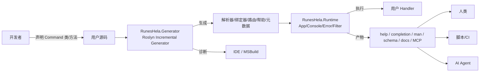
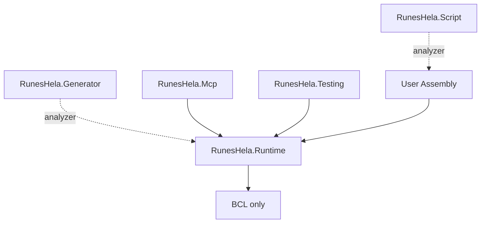
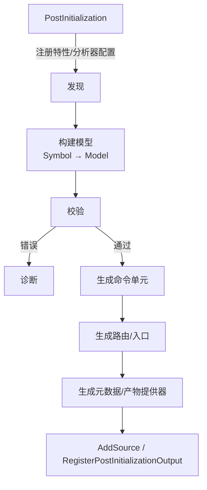
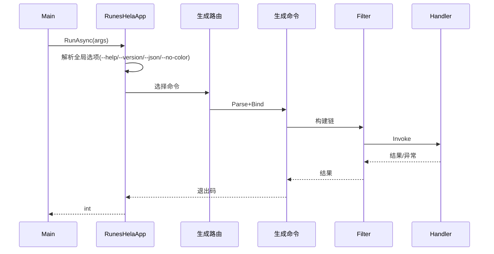

# 02 技术设计文档

> 项目名称：**RunesHela**（已选定，2026-11-26）
> 版本：v0.1（设计基线，待决策）
> 关联：[00 调研](./00-深度调研与机会分析.md) · [01 PRD](./01-产品需求文档-PRD.md) · [03 任务](./03-实现任务分解.md) · [04 清单](./04-验收与质量检查清单.md) · [05 ADR](./05-架构决策记录-ADR.md) · [06 决策记录](./06-决策记录.md)

---

## 1. 文档目的与范围

本文定义 RunesHela 的**可实现技术方案**：包结构、编译期模型、生成器流水线、运行时、类型系统、Agent 契约、产物生成、性能工程、AOT 策略、诊断、测试、安全与版本策略。

本文不包含：
- 具体代码实现（按用户要求，开发前不写代码）。
- 命名/许可证/MVP 决策的理由（见 06 决策记录）。
- 营销与定价。

---

## 2. 设计原则

| # | 原则 | 技术含义 | 反面案例 |
|---|---|---|---|
| P1 | **编译期优先** | 能在生成期确定的（名称、类型、默认值、帮助、候选集）不放到运行时 | 运行时反射扫描命令 |
| P2 | **单遍解析** | 参数从左到右一次扫描完成；不做回溯、不做多轮匹配 | 复杂语法导致多次遍历 |
| P3 | **零反射** | 不调用 `Type.GetType` / `Activator` / `MethodInfo.Invoke` / `Expression.Compile` | 运行时构造命令对象 |
| P4 | **零第三方依赖** | 运行时仅依赖 BCL；可选集成由用户显式添加 | 为日志/配置拖入整棵依赖树 |
| P5 | **单一事实源** | 所有产物从同一 `CommandModel` 派生 | 手写 help 与代码不一致 |
| P6 | **契约优先** | 输出格式、错误结构、退出码是公共 API | 错误信息随版本漂移 |
| P7 | **确定性** | 输出顺序、生成文件、构建结果可复现 | 依赖字典遍历顺序 |
| P8 | **可验证** | 每个承诺有测试/基准/门禁 | “我觉得很快” |
| P9 | **可组合** | 不绑架渲染、DI、日志、序列化 | 框架内置一套 UI |
| P10 | **失败可诊断** | 生成器/运行时错误都有代码、建议、文档 | 空白异常 |

---

## 3. 系统上下文



**关键边界**：
- 生成器只读源码符号，不读运行时。
- 运行时只读生成的描述符/常量，不扫描程序集。
- 产物命令只读生成模型，不重新解析源码。

---

## 4. 包布局与依赖

### 4.1 包清单（建议）

| 包 | 类型 | 内容 | 依赖 | 版本策略 |
|---|---|---|---|---|
| `RunesHela` | 运行时 + 分析器 | 特性、`RunesHelaApp`、`IConsole`、错误模型、过滤器、结果渲染；内置生成器 | BCL only | 与生成器同版本 |
| `RunesHela.Script` | 纯分析器（可选） | 方法优先微命令；生成独立入口类型 | 无 | 独立小版本 |
| `RunesHela.Mcp` | 运行时（可选） | MCP stdio server 适配、Manifest 输出 | `ModelContextProtocol`（用户可选）或零依赖 JSON-RPC 实现 | 跟随主版本 |
| `RunesHela.Testing` | 运行时（可选） | `InMemoryConsole`、快照辅助、断言 | xUnit/Verify 可选 | 跟随主版本 |
| `RunesHela.Templates` | 模板 | `dotnet new runeshela-cli` | 无 | 独立 |
| `RunesHela.Analyzers` | 分析器（可选） | Agent 就绪度/风格规则（RHL1xx） | Roslyn | 独立 |

> **为什么不是纯 analyzer-only**：类优先需要公共特性与入口类型；MCP/测试/渲染需要共享运行时。纯 analyzer-only 会导致生成代码膨胀、缺陷修复必须重新生成、无法提供可选能力。见 [ADR-001](./05-架构决策记录-ADR.md)。
> **但仍坚持“零第三方依赖”**：`RunesHela` 的依赖图只有 BCL。
> **打包方式**：`RunesHela` 是**单个 NuGet 包**，内含运行时程序集与 `RunesHela.Generator` 分析器程序集（置于 `analyzers/dotnet/cs`）；`RunesHela.Generator` 不作为独立包发布，避免版本错配。

### 4.2 目标框架

| 程序集 | TFM | 说明 |
|---|---|---|
| `RunesHela` | `net10.0` | net10.0 LTS 单目标；利用 `ISpanParsable`、`SearchValues`、`FrozenDictionary` 等 |
| `RunesHela.Generator` | `netstandard2.0` | Roslyn 分析器要求 |
| `RunesHela.Script` | `netstandard2.0`（分析器） | 生成的代码兼容 C# 14 |
| `RunesHela.Mcp` | `net10.0` | 可选 |
| `RunesHela.Testing` | `net10.0` | 可选 |

> **支持周期（D-02=C）**：仅支持 `net10.0`（LTS，支持至 2028-11）。放弃 net8/net9 存量，换取零开销、最小 CI 矩阵与最新语言特性。net9 已于 2026-05 结束支持，net8 LTS 已于 2026-11 结束支持。

### 4.3 程序集依赖图



---

## 5. 编译期模型

### 5.1 发现策略

| 入口 | 发现方式 | 说明 |
|---|---|---|
| 类优先 | `ForAttributeWithMetadataName("RunesHela.CommandAttribute")` | 只处理标注类型，增量友好 |
| 嵌套子命令 | 遍历 `INamedTypeSymbol.ContainingType` | 父必须是 `[Command]`；否则诊断 |
| 批量注册 | `[RegisterCommands]` | 标记类中的公共方法作为命令（P1） |
| 方法优先 | `CreateSyntaxProvider` 匹配 `RunesHelaScript.Run(...)` 调用 | 分析 lambda 参数列表（P1） |
| 根命令 | `[Command("")]` 或 `[RootCommand]` | 最多一个根；多个则诊断 |

**自动注册约定**：入口程序集中所有顶层 `[Command]` 类自动进入命令树；嵌套类只作为其父的子命令。显式 `RunesHelaApp.Create().Add<T>()` 可覆盖默认集合。

**访问性约束（“无需 partial”的代价）**：
- 命令类型必须为 `public` 或 `internal`（不能是 `private` 嵌套）。
- 被绑定属性必须为 `public`/`internal`，且具有 `set` 或 `init` 访问器。
- handler 方法必须为 `public`/`internal`。
- 生成器通过外部绑定类构造与赋值，不向用户类型内部注入成员；因此无需 `partial`、接口或基类。
- 不满足访问性时给出明确诊断（建议提升访问性或改用显式注册）。

### 5.2 模型 IR（不可变、可相等）

```text
CommandModel
├─ Name, Aliases[], DisplayName, Summary, Description
├─ IsRoot, IsHidden, IsDestructive, IsIdempotent
├─ Parameters[]  : ParameterModel
├─ Options[]     : OptionModel
├─ Subcommands[] : CommandModel
├─ Examples[]    : ExampleModel
├─ ExitCodes[]   : ExitCodeModel
├─ Handler       : HandlerModel
├─ Filters[]     : FilterModel
└─ Source        : LocationModel

OptionModel
├─ LongName, ShortName?, Aliases[]
├─ ValueName, Arity, IsFlag, IsNegatable, IsRepeatable
├─ Type (TypeRef), IsRequired, DefaultValue?, HasDefault
├─ EnvVar?, ConfigKey?, IsSecret
├─ Validation[]  : ValidationModel
├─ Summary, Description
└─ IsHidden

ParameterModel
├─ Position, Name, Type, IsRequired, IsParams
├─ DefaultValue?, EnvVar?, ConfigKey?
├─ Validation[]
└─ Summary, Description
```

**实现要求**：
- 所有集合使用 `EquatableArray<T>`（自定义 struct），避免增量缓存失效。
- `TypeRef` 只存 `FullyQualifiedName`、`IsValueType`、`NullableAnnotation` 等字符串/布尔，不持有 `ISymbol`。
- 字符串统一缓存（`StringComparer.Ordinal`）。
- 模型可序列化为 JSON（用于 `describe`/`schema`）。

### 5.3 命名规则

| 对象 | 默认规则 | 示例 | 覆盖方式 |
|---|---|---|---|
| 命令名 | 类型名去 `Command` 后缀 → kebab-case | `DeployCommand` → `deploy` | `[Command("deploy")]` |
| 嵌套路径 | 父名 + 空格 + 子名 | `remote add` | `[Command("remote add")]` |
| 选项名 | 属性名 → kebab-case | `TimeoutSeconds` → `--timeout-seconds` | `[Option("timeout")]` |
| 短名 | 无默认（避免冲突） | — | `[Option(Short = 't')]` |
| 位置参数 | 按 `[Argument(order)]` 或构造参数顺序 | — | 显式 order |
| 值名 | 类型名 → 大写 | `int` → `<INT>` | `ValueName` |

**大小写策略**：选项名大小写不敏感，小写精确匹配优先；命令名大小写敏感。理由：降低输入错误成本，同时保持路由确定性。

### 5.4 校验与诊断（生成期）

校验顺序：
1. 结构校验（名称合法、层级合法、无循环）。
2. 唯一性校验（命令路径、选项名/短名、位置序号）。
3. 类型校验（可解析、可赋值、AOT 安全）。
4. 语义校验（必填+默认冲突、可选位置参数后出现必填、`params` 只能最后）。
5. 约定校验（描述缺失、破坏性命令缺 `--yes`）→ 警告/信息。

任何错误都产出诊断并**跳过该命令的代码生成**，避免级联错误；应用级错误导致入口生成失败并给出明确信息。

---

## 6. 生成器架构

### 6.1 流水线



### 6.2 增量与缓存

- 使用 `IIncrementalGenerator`；每个阶段输出 `EquatableArray`/record。
- 禁止在管道中捕获 `Compilation`、`ISymbol`、`SyntaxNode`。
- 使用 `ForAttributeWithMetadataName` 减少语法遍历。
- 模型阶段以“类型完全限定名 + 语义版本”为键；文档注释变化需触发重新生成（通过 `DocumentationComment` 文本进入模型）。
- 生成器自带基准：1/10/50/200 命令的首次与增量耗时。

### 6.3 生成物清单

| 生成物 | 触发 | 形态 | 运行时成本 |
|---|---|---|---|
| 命令解析器 | 每个命令 | 静态方法 + 常量 | 0 |
| 属性绑定/构造 | 每个命令 | 静态方法 | 1 次对象构造 |
| 路由 | 应用级 | 嵌套 `switch` | 0 |
| 人类帮助 | 每个命令 | `const string` | 0（一次写入） |
| JSON 帮助 | 每个命令 | 惰性构建/常量 | 仅调用时 |
| 命令模型 | 应用级 | 惰性 `CommandModel` | 仅产物命令 |
| 补全脚本 | 应用级 | 运行时构建 | 仅补全命令 |
| Man/Docs | 应用级 | 运行时构建 | 仅对应命令 |
| Schema/MCP Manifest | 应用级 | 运行时构建 | 仅对应命令 |
| 诊断 | 编译期 | `Diagnostic` | 0 |

**帮助为何用常量**：帮助是最高频的“非业务输出”，且内容在编译期完全确定。常量写入避免 `StringBuilder`、格式化、分配。错误信息同理：常用错误用常量模板，变量部分用 `string.Concat`/`Write`。

### 6.4 生成代码形态（示意，非实现）

**入口与路由**：

```csharp
// <auto-generated/>
internal static class __RunesHelaEntry
{
    public static ValueTask<int> RunAsync(string[] args, IServiceProvider? services, CancellationToken ct)
    {
        // 若声明了根命令（[Command("")]），args 为空时执行根命令；否则显示帮助
        if (args.Length == 0) { __RunesHelaHelp.WriteRoot(); return new(0); }
        switch (args[0])
        {
            case "deploy": return __RunesHela_Deploy.RunAsync(args.AsSpan(1), services, ct);
            case "remote": return __RunesHela_Remote.RunAsync(args.AsSpan(1), services, ct);
            case "--help" or "-h": __RunesHelaHelp.WriteRoot(); return new(0);
            case "--version": __RunesHelaVersion.Write(); return new(0);
            default: return __RunesHelaErrors.UnknownCommand(args[0]);
        }
    }
}
```

> 说明：有根命令时，`args.Length == 0` 走根命令；无根命令时显示帮助。根命令与顶层子命令可共存（根命令处理“无子命令”的情况）。

**命令解析（单遍）**：

```csharp
// <auto-generated/>
internal static class __RunesHela_Deploy
{
    public static ValueTask<int> RunAsync(ReadOnlySpan<string> args, IServiceProvider? services, CancellationToken ct)
    {
        string? env = null; bool envSet = false;
        int timeout = 30; bool timeoutSet = false;
        bool yes = false, dryRun = false;

        for (int i = 0; i < args.Length; i++)
        {
            var a = args[i];
            if (a == "--") { /* 其余为位置参数 */ break; }
            if (a.Length > 2 && a[0] == '-' && a[1] == '-')
            {
                var body = a.AsSpan(2);
                var eq = body.IndexOf('=');
                var name = eq >= 0 ? body[..eq] : body;
                var inlineValue = eq >= 0 ? body[(eq + 1)..] : default;

                if (name.SequenceEqual("environment") || name.SequenceEqual("env"))
                {
                    if (!TryReadValue(args, ref i, inlineValue, out var raw)) return __RunesHelaErrors.MissingValue("environment");
                    env = raw; envSet = true; continue;
                }
                if (name.SequenceEqual("timeout"))
                {
                    if (!TryReadValue(args, ref i, inlineValue, out var raw) || !int.TryParse(raw, out timeout))
                        return __RunesHelaErrors.InvalidValue("timeout", raw);
                    timeoutSet = true; continue;
                }
                if (name.SequenceEqual("yes")) { yes = true; continue; }
                if (name.SequenceEqual("dry-run")) { dryRun = true; continue; }
                if (name.SequenceEqual("help")) { __RunesHelaHelp.WriteDeploy(); return new(0); }
                return __RunesHelaErrors.UnknownOption("deploy", name);
            }
            // 短选项、位置参数...
        }

        if (!envSet) env = Environment.GetEnvironmentVariable("APP_ENV");
        if (env is null) return __RunesHelaErrors.MissingRequired("environment");
        if (timeout < 1 || timeout > 3600) return __RunesHelaErrors.Validation("timeout", "1..3600");

        var cmd = new DeployCommand(/* 生成构造注入 */);
        cmd.Environment = env;
        cmd.TimeoutSeconds = timeout;
        cmd.Yes = yes;
        cmd.DryRun = dryRun;
        return cmd.RunAsync(ct);
    }
}
```

**要点**：
- 只扫描一次；无正则、无 `Split`、无字典。
- `ReadOnlySpan<char>` 比较避免子串分配。
- 错误返回结构体/短路径，正常路径无异常。
- 帮助/版本走常量路径。
- 值读取支持 `--opt=value` 与 `--opt value`。

### 6.5 可读性与调试

- 生成文件命名：`RunesHela.<Assembly>.<Feature>.g.cs`，`<auto-generated/>` + `GeneratedCode` 属性。
- 命名空间：`RunesHela.Generated.<Hash>`，避免与用户冲突。
- 默认不注入 `#line`（保护增量缓存与可读性）；提供 MSBuild 属性 `RunesHelaEmitLineDirectives=true` 用于调试映射。
- 生成代码不使用 `unsafe`，除非用户显式启用 `RunesHelaAllowFunctionPointers`。
- 生成代码不使用 `dynamic`、不使用 `ref struct` 逃逸。

### 6.6 失败与降级

| 情况 | 行为 |
|---|---|
| 用户定义非法 | 诊断错误；跳过该命令；入口生成失败并给出“修复后重试” |
| 生成器内部异常 | 捕获 → `RHL999` 警告（含异常类型/消息，不含堆栈除非 `RunesHelaDebugGenerators=true`）；生成兜底入口，运行时输出明确错误 |
| Roslyn 版本不兼容 | 包级 MSBuild 检查 → 明确错误 |
| 不支持的类型 | `RHL004` 错误 + 建议（实现 `IParsable<T>` 或改用 `string`） |

---

## 7. 运行时架构

### 7.1 类型与职责

| 类型 | 职责 | 分配 |
|---|---|---|
| `RunesHelaApp` | 入口、命令注册、全局选项、生命周期 | 1 次（可静态复用） |
| `CommandDescriptor` | 生成的命令元数据与调用委托 | 静态只读 |
| `ArgumentReader`（`ref struct`） | 单遍读取、`--` 处理、值内联 | 0 |
| `BindingContext` | 当前命令、已解析值、错误累积 | 栈上/复用 |
| `IConsole` | stdout/stderr/输入抽象；TTY 能力 | 1 次 |
| `RunesHelaError` | 结构化错误 | 仅错误路径 |
| `IResult` / `ResultWriter` | 用户数据输出（text/markdown/json） | 用户决定 |
| `IFilter` | 中间件 | 每个过滤器 1 次（可选） |
| `ExitCode` | 退出码常量与映射 | 0 |

### 7.2 执行流程



### 7.3 全局选项

| 选项 | 作用 | 优先级 |
|---|---|---|
| `-h, --help` | 帮助 | 最高（在 `--` 之前） |
| `--version` | 版本 | 高 |
| `--json` | 结构化输出（错误/结果/帮助） | 高 |
| `--format <text\|markdown\|json>` | 显式格式 | 高 |
| `--no-color` / `NO_COLOR` | 去色 | 高 |
| `--plain` | 纯文本（无框线/无 ANSI） | 高 |
| `--quiet` / `-q` | 仅错误 | 中 |
| `--verbose` / `-v` | 诊断到 stderr | 中 |
| `--no-input` | 禁止交互 | 高 |
| `--yes` / `-y` | 跳过确认 | 命令级 |
| `--dry-run` | 演练 | 命令级 |
| `--` | 终止符 | 语法级 |

全局选项由框架统一解析，命令可声明冲突（诊断）。

### 7.4 过滤器

```csharp
public interface IRunesHelaFilter
{
    ValueTask<CommandResult> InvokeAsync(CommandContext context, Func<CommandContext, ValueTask<CommandResult>> next);
}
```

- 顺序：注册顺序；`UseFilter<T>()` 在编译期确定并生成静态链。
- 分配：每个过滤器 1 个实例 + 1 个委托（可选优化为静态方法）。
- 用途：计时、日志、认证、限流、重试、退出码映射。
- 异常：过滤器可捕获/转换；未处理异常到顶层映射。

> 不在 MVP 承诺“过滤器零分配”；无过滤器路径才是 0 B 基准。

### 7.5 控制台抽象

```csharp
public interface IConsole
{
    bool IsInputRedirected { get; }
    bool IsOutputRedirected { get; }
    bool IsErrorRedirected { get; }
    bool IsAnsiSupported { get; }
    TextWriter Out { get; }
    TextWriter Error { get; }
    TextReader In { get; }
    void WriteResult(IResult result);
}
```

- 默认实现包装 `System.Console`；测试实现为内存流。
- 颜色/宽度能力探测一次并缓存。
- 所有框架输出走 `Out`/`Error`，禁止直接 `Console.WriteLine`。

### 7.6 错误模型

```csharp
public sealed class RunesHelaError
{
    public required string Code { get; init; }        // RHL_USAGE_UNKNOWN_OPTION
    public required string Message { get; init; }
    public string? Hint { get; init; }
    public IReadOnlyList<string> NextSteps { get; init; } = [];
    public string? DocsUrl { get; init; }
    public int ExitCode { get; init; } = 1;
    public string? CommandPath { get; init; }
    public IReadOnlyDictionary<string, string>? Details { get; init; }
}
```

**渲染规则**：

| 场景 | 输出 |
|---|---|
| TTY + text | `Error: <message>`；`Hint: ...`；`Next: ...` |
| 非 TTY / `--json` | JSON 信封（见 §10.4） |
| 非 TTY 默认 | Markdown（标题 + 可用选项 + 下一步） |
| `--verbose` | 追加异常类型/堆栈（仅未知异常） |

### 7.7 退出码

| 码 | 含义 | 典型场景 |
|---:|---|---|
| 0 | 成功 | 正常完成 |
| 1 | 一般失败 | 业务错误、未知异常 |
| 2 | 用法错误 | 未知选项、缺少参数、校验失败 |
| 3 | 配置错误 | 配置文件缺失/格式错误/键非法 |
| 4 | 未找到 | 资源不存在 |
| 5 | 权限/认证 | 403/401、权限不足 |
| 6 | 冲突 | 已存在、版本冲突 |
| 7 | 超时 | 操作超时 |
| 130 | 中断 | SIGINT（128+2） |

> 可扩展：用户可通过 `RunesHelaError.ExitCode` 自定义；文档要求保持语义稳定。

### 7.8 取消与信号

- 生成代码检测 `CancellationToken` 参数；有则注册 `PosixSignalRegistration`（SIGINT/SIGTERM/SIGHUP）。
- 首次信号：取消 token，阻止立即终止；启动超时计时（默认 5s，可配置）。
- 超时后：强制退出（130）。
- 无 `CancellationToken` 参数：保持默认行为（立即终止）。
- 双 Ctrl+C：第二次立即强制退出。

### 7.9 日志

- 可选 `Microsoft.Extensions.Logging` 桥接；未引用时无操作。
- 日志只写 stderr；`--json` 时输出 NDJSON 日志事件（P2）。
- 默认级别：Warning；`--verbose` → Debug；`--quiet` → Error。
- 敏感值过滤：日志模板参数经 `SecretRedactor` 处理。

---

## 8. 类型系统与绑定

### 8.1 支持矩阵

| 类型 | 解析方式 | 分配 | 备注 |
|---|---|---|---|
| `string` | 原样引用 | 0 | 不复制 |
| `char` | 单字符校验 | 0 | 多字符报错 |
| `bool` | 旗标/显式 `=true/false` | 0 | 支持 `--no-*` |
| 数值类型 | `TryParse(ReadOnlySpan<char>)` | 0 | InvariantCulture |
| `enum` | 生成 `switch`（含别名） | 0 | 大小写不敏感；失败给候选 |
| `Guid` | `Guid.TryParse` | 0 | |
| `DateTime`/`DateTimeOffset` | `TryParse(span, Invariant, RoundtripKind)` | 0 | 明确时区策略 |
| `TimeSpan` | `TryParse(span, Invariant)` | 0 | 支持 `30s`? 仅标准格式 |
| `Uri` | `new Uri(string)` | 1 | 校验绝对/相对 |
| `FileInfo`/`DirectoryInfo` | `new` | 1 | 默认不访问文件系统 |
| `T?` | 内层解析 | 0 | 缺失 = null |
| `T[]` | 计数后分配 | 1 | 逗号分隔/重复选项 |
| `List<T>`/`IReadOnlyList<T>` | 构建 | 2+ | 顺序保持 |
| `params T[]` | 剩余参数 | 1 | |
| 自定义 `IParsable<T>` | 静态抽象调用 | 取决于实现 | 推荐 `ISpanParsable` |
| `CancellationToken` | 特殊注入 | 0 | 不作为 CLI 参数 |
| `IServiceProvider` 服务 | 构造注入 | 取决于容器 | 不作为 CLI 参数 |

### 8.2 转换优先级

1. 内置专用解析器（数值/枚举/Guid/时间）。
2. `ISpanParsable<T>` → `IParsable<T>`。
3. 用户注册的 `IRunesHelaConverter<T>`。
4. 编译错误（`RHL004`），不退化到 `TypeConverter`/JSON。

> 明确不做“隐式 JSON 解析”，避免不可预测与 AOT 问题；需要时用户显式使用自定义转换器。

### 8.3 分配预算

| 路径 | 预算 | 说明 |
|---|---:|---|
| 解析 5 选项 | 0 B | 不含 args 数组本身 |
| 绑定 5 值 | 0 B | 值类型/字符串引用 |
| 帮助 | ≤ 64 B | 常量写入；控制台缓冲另计 |
| 错误 | ≤ 512 B | 仅失败路径 |
| 命令实例 | 1 对象 | 用户类型，不可避免 |
| 过滤器 | 1/过滤器 | 可选 |
| 数组选项 | 1+ | 不可避免 |

---

## 9. 配置与环境

### 9.1 优先级

```text
CLI 参数  >  环境变量  >  配置文件  >  默认值
```

规则：
- 显式 CLI 值（包括空字符串）覆盖 ENV/配置。
- 布尔旗标：CLI 出现即 true；`--no-x` 为 false；ENV 接受 `1/0`、`true/false`、`yes/no`、`on/off`。
- 配置键使用点路径：`deploy.environment`；默认键为 `command.path.option-name`，可用 `[Option(Config = "...")]` 覆盖。
- 缺失必填 → 用法错误（退出码 2）；配置文件本身非法 → 配置错误（退出码 3）。
- ENV 名称默认按 `APP_COMMAND_OPTION` 生成（大写、非字母数字转 `_`），可用 `[Option(Env = "...")]` 覆盖。

### 9.2 配置源（V1）

| 源 | 格式 | 依赖 | 说明 |
|---|---|---|---|
| 文件 | JSON | `System.Text.Json`（BCL） | 默认 `appsettings.json`，可用 `--config` 指定 |
| ENV | 字符串 | BCL | `APP_` 前缀约定 |
| 内存 | 字典 | BCL | 测试/嵌入 |

- 解析使用内置最小 JSON 解析器（无反射、AOT 安全、零第三方依赖）；V1.0 起不再使用 `System.Text.Json`。
- 配置 Schema 由模型生成（`schema --config`）。
- 不自动监听文件变化（CLI 单次执行）。

**发现顺序**（仅显式或约定位置，不做全盘扫描）：
1. `--config <path>`（最高，可位于命令前后）
2. 环境变量 `RHL_CONFIG`
3. 当前目录 `appsettings.json`（需 `[assembly: RunesHelaConfigFile]` 启用隐式发现）
4. 用户目录 `~/.config/<app>/appsettings.json`（同上）

> 未启用隐式发现时只读取显式路径，保证 AC-04 的绑定热路径零 IO、零分配。
> 找不到配置文件不算错误；显式指定的文件不存在 → 退出码 3。
> `--config` 与 `RHL_CONFIG` 在帮助/`describe`/`docs` 中可见；实际使用的文件路径可通过 `RunesHelaConfiguration.Path` 获取。

### 9.3 脱敏

- `[Secret]` 选项：帮助显示 `***`；`describe` 不含默认值；日志/错误/`--verbose` 全部替换。
- 配置文件中疑似密钥键（`token`/`secret`/`password`/`key`）默认脱敏，除非显式 `[Secret(false)]`。
- 错误信息中的用户输入值：长度截断 + 敏感键脱敏。

---

## 10. Agent 原生契约

### 10.1 设计目标

让 Agent 能够：
1. **发现**能力（`--help`、`describe`、`schema`）。
2. **一次调用成功**（明确类型、必需性、默认值、示例）。
3. **失败后自愈**（结构化错误 + 下一步）。
4. **安全执行**（非交互、破坏性操作守卫、dry-run）。
5. **稳定解析**（stdout 纯数据、稳定排序、固定 Schema）。

### 10.2 输出模式

| 模式 | 触发 | stdout | stderr |
|---|---|---|---|
| Human | TTY 且未指定格式 | 人类可读文本/表格 | 诊断/进度 |
| Markdown | 非 TTY 且未指定 `--json` | Markdown 表格/列表 | 诊断 |
| JSON | `--json` 或 `--format json` | JSON 信封 | NDJSON 日志（可选） |
| Plain | `--plain` | 无 ANSI、无框线 | 诊断 |

- 框架级命令（help/describe/schema/completion/错误）严格遵守此表。
- 用户数据输出通过 `IResult`/`ResultWriter`，默认遵循同一策略。

### 10.3 帮助分层

```text
app --help                 # 顶层：命令列表、全局选项、示例
app deploy --help          # 命令级：参数、选项、ENV、默认值、示例、退出码
app deploy --help --json   # 机器可读（含 env/configKey/默认值/类型）
app describe               # 全量模型（含所有子命令）
app schema                 # 配置 JSON Schema（键/类型/默认值）
```

### 10.4 JSON 信封

**成功**：

```json
{
  "ok": true,
  "schemaVersion": "1.0",
  "data": { },
  "meta": {
    "command": "deploy",
    "durationMs": 12,
    "warnings": []
  }
}
```

**失败**：

```json
{
  "ok": false,
  "schemaVersion": "1.0",
  "error": {
    "code": "RHL_USAGE_UNKNOWN_OPTION",
    "message": "Unknown option '--prot'.",
    "hint": "Did you mean '--port'?",
    "nextSteps": [
      "Run 'app deploy --help' to list options.",
      "Use '--' to pass the remaining arguments through."
    ],
    "docsUrl": "https://runeshela.dev/errors/RHL_USAGE_UNKNOWN_OPTION",
    "command": "deploy",
    "exitCode": 2
  }
}
```

**稳定性**：字段名为 API；新增字段允许，删除/改义需大版本。`schemaVersion` 字段用于演进。

### 10.5 破坏性操作守卫

```csharp
[Command("delete")]
[Destructive(RequiresConfirmation = true)]
public sealed class DeleteCommand { /* ... */ }
```

行为矩阵：

| 环境 | `--yes` | 行为 |
|---|---|---|
| TTY | 否 | 交互确认（Y/N） |
| TTY | 是 | 直接执行 |
| 非 TTY | 否 | **立即失败**（退出码 2，`nextSteps` 提示加 `--yes`） |
| 非 TTY | 是 | 直接执行 |
| `--no-input` + 无 `--yes` | 否 | 立即失败 |

> 这是防止 Agent 挂起的关键设计，也是与现有框架的显著差异。

### 10.6 自描述

- `describe`：完整命令模型（命令、别名、参数、选项、类型、默认值、ENV、配置键、校验、退出码、示例、危险级别）。
- `schema`：JSON Schema（命令调用参数 + 配置文件）。
- `completion`：四 shell 脚本。
- `mcp --manifest`：MCP 工具清单（P2），`mcp --stdio` 提供 JSON-RPC server。

---

## 11. 产物生成

### 11.1 人类帮助

布局规则：
- 宽度：`Math.Min(consoleWidth, 100)`；最小 60；80 列优先。
- 顺序：Usage → Summary → Arguments → Commands → Options → Examples → Exit codes → Env/Config（verbose）。
- 对齐：CJK 宽度按 East Asian Width 计算；不依赖第三方库（内置小型宽度表）。
- 颜色：仅强调（命令名/选项名/错误）；`NO_COLOR`/非 TTY 关闭。
- 分页：不内置分页（交给 `less`）；`--plain` 关闭框线。

### 11.2 机器可读帮助

- `--help --json` 输出单命令模型；`describe` 输出全树。
- 字段与 §5.2 模型一致；`schemaVersion` 固定。
- 所有集合稳定排序（声明顺序）。

### 11.3 Shell 补全

| Shell | 静态脚本 | 动态补全 |
|---|---|---|
| bash | `complete -F` + 命令/选项列表 | `__complete` 隐藏命令 |
| zsh | `#compdef` + `_arguments` | 同上 |
| fish | `complete -c` | 同上 |
| pwsh | `Register-ArgumentCompleter` | 同上 |

- 静态脚本由模型生成，包含命令树与选项；文件补全由 shell 原生处理。
- 动态协议：`app __complete <args...>` 输出候选（每行 `value\tdescription`），供脚本消费；对 Agent 不暴露。
- 安全：候选值转义；不执行用户输入。

### 11.4 Man / Docs

- `man`：生成 roff（`.TH`/`.SH`/`.TP`），支持 `man -l`。
- `docs --markdown`：每命令一节，含 Usage/参数/选项/示例/退出码；可直接放入文档站。
- 两者均从模型生成，CI 校验与 help 一致。

### 11.5 MCP（P2）

- `mcp --manifest`：输出工具清单（`name`/`description`/`inputSchema`/`annotations`），仅包含可执行且未隐藏的命令；嵌套路径转为 `parent_child_leaf`。
- `mcp --stdio`：逐行 JSON-RPC 2.0，支持 `initialize`、`notifications/initialized`、`ping`、`tools/list`、`tools/call`。
- 参数映射：`x-runeshela-position` 映射位置参数，`x-runeshela-option` 映射选项；破坏性命令附带 `yes` 布尔确认项。
- 注解：`readOnlyHint=false`、`destructiveHint=IsDestructive`、`idempotentHint=!IsDestructive`、`openWorldHint=true`（保守默认值）。
- 结果：stdout/stderr 作为 `content` 文本项；`isError` 由非零退出码决定；`structuredContent.exitCode` 提供机器可读状态。
- 实现：内置于核心生成入口（同 `describe`/`schema`），零第三方依赖；不引入独立 `RunesHela.Mcp` 包（M7 范围收敛，见 M7 报告）。

---

## 12. 性能工程

### 12.1 测量方法

| 维度 | 工具 | 方法 | 报告 |
|---|---|---|---|
| 微基准 | BenchmarkDotNet | `[MemoryDiagnoser]`，ShortRun | ns/op、B/op、GC |
| 冷启动 | hyperfine | 30 次，warmup 5，p50/p95 | ms |
| AOT 体积 | `dotnet publish` + `stat` | 空应用 vs 示例 | KB |
| 生成器 | 生成器驱动基准 + MSBuild 计时 | 1/10/50/200 命令，首次/增量 | ms |
| 端到端 | 脚本矩阵 | 100 命令 × 典型参数 | ms |

**基线定义**：
- 硬件写入 `benchmarks/hardware.md`；CI 使用固定 runner。
- 每次发布保存 JSON 基线；PR 对比基线，超阈值失败。
- 公开报告包含原始数据与方法，允许复现。

### 12.2 预算

| 场景 | 目标 | 失败阈值 |
|---|---|---|
| 解析+绑定+派发（5 选项） | ≤ 1 µs / 0 B | > 1.1 µs 或 > 0 B |
| 帮助 | ≤ 5 µs / ≤ 64 B | > 5.5 µs 或 > 128 B |
| 错误 | ≤ 5 µs / ≤ 512 B | > 5.5 µs 或 > 1 KB |
| AOT 启动额外 | ≤ 1 ms | > 1.5 ms |
| AOT 体积增量 | ≤ 100 KB | > 150 KB |
| 生成器 no-op | ≤ 30 ms | > 50 ms |

> 阈值需在 M0 用真实数据校准；PRD 与本文同步更新。

### 12.3 热路径技术

1. **单遍扫描**：`for` + `ReadOnlySpan<char>`，无 LINQ/正则/`Split`。
2. **常量比较**：`SequenceEqual("literal")`；长度优先，避免哈希。
3. **零装箱**：泛型静态抽象；避免 `object`/`IComparable`。
4. **无异常正常路径**：错误用返回值；异常仅用于未知错误。
5. **帮助常量化**：`const string` 一次写入。
6. **枚举 switch**：生成大小写/别名分支，避免 `Enum.Parse` 反射。
7. **候选集预计算**：未知选项的 did-you-mean 候选在生成期确定，错误路径线性扫描。
8. **可选函数指针**：`RunesHelaAllowFunctionPointers=true` 时生成 `delegate* managed<...>`，消除委托分配。
9. **避免闭包**：生成静态方法；过滤器链显式构造。
10. **AOT 友好**：无动态代码；trimmer 可见所有类型。

### 12.4 分配来源清单

| 来源 | 是否可控 | 对策 |
|---|---|---|
| `string[] args` | 否（运行时） | 不计入框架预算 |
| `ReadOnlySpan` 切片 | 是 | 0 |
| 子字符串 | 是 | 避免；用 span 比较 |
| 装箱 | 是 | 泛型/专用解析 |
| 异常 | 是 | 仅异常路径 |
| 命令实例 | 部分 | 用户类型，1 次 |
| 数组/列表选项 | 否 | 不可避免 |
| 帮助字符串 | 是 | 常量 |
| 日志/格式化 | 是 | 惰性/条件 |

---

## 13. Native AOT 与 Trim

### 13.1 规则

| 规则 | 说明 |
|---|---|
| 禁止反射 | 无 `Type.GetType`、`Activator`、`MethodInfo.Invoke` |
| 禁止动态代码 | 无 `Expression.Compile`、`IL.Emit`、`MakeGenericType` |
| 禁止无源 JSON | 不使用 `JsonSerializer.Serialize<T>`；用 `Utf8JsonWriter`/`JsonDocument` |
| 禁止 `TypeConverter` | 用 `IParsable<T>`/自定义转换器 |
| 静态引用 | 生成代码直接引用用户类型，trimmer 可见 |
| 注解 | 运行时可选的 API 标注 `[RequiresUnreferencedCode]`/`[DynamicallyAccessedMembers]` |
| 警告即错误 | 示例项目启用 `TrimmerSingleWarn=false` + `WarningsAsErrors` |

### 13.2 DI 与 AOT

- 生成代码直接 `new Command(...)`；构造参数通过 `IServiceProvider.GetService(typeof(T))` 解析。
- 服务注册由用户负责；推荐显式工厂注册。
- 不内置容器，不扫描程序集。
- 无 `IServiceProvider` 时：仅支持无参构造；否则明确错误。

### 13.3 AOT 测试矩阵

| 维度 | 值 |
|---|---|
| RID | `win-x64`、`linux-x64`、`linux-musl-x64`、`osx-x64`、`osx-arm64`、`linux-arm64` |
| 配置 | AOT、Trim、Single-file、ReadyToRun |
| 检查 | 构建成功、0 警告、运行冒烟、`--help` 输出一致 |
| 体积 | 记录基线，超预算失败 |

---

## 14. 诊断与 IDE 体验

### 14.1 诊断码

| 码 | 级别 | 含义 | 修复建议 |
|---|---|---|---|
| RHL001 | Error | 命令路径重复 | 重命名或显式指定 |
| RHL002 | Error | 选项名/短名冲突 | 改名或移除 |
| RHL003 | Error | 必填与默认值冲突 | 移除默认值或改为可选 |
| RHL004 | Error | 不支持的类型 | 实现 `IParsable<T>` 或改用 `string` |
| RHL005 | Info | 缺少命令摘要 | 添加 XML 文档注释 |
| RHL006 | Error | 未找到处理器方法 | 添加 `Run/RunAsync` 或 `[Handler]` |
| RHL007 | Error | 多个处理器方法 | 显式标注 `[Handler]` |
| RHL008 | Warning | 破坏性命令缺少确认守卫 | 添加 `[Destructive]` 或 `--yes` |
| RHL009 | Error | 可选位置参数后出现必填 | 调整顺序 |
| RHL010 | Error | 位置序号重复/跳号 | 修正 order |
| RHL011 | Error | `params` 不在最后 | 调整参数顺序 |
| RHL012 | Warning | 异步处理器命名不匹配返回类型 | 改名或改返回 |
| RHL013 | Error | 命令名含非法字符 | 使用 kebab-case |
| RHL014 | Warning | 与保留命令/选项冲突（help/version/…） | 改名 |
| RHL015 | Warning | 敏感选项未标记 `[Secret]` | 添加标记 |
| RHL016 | Error | 配置键冲突 | 修改键 |
| RHL017 | Info | 缺少示例 | 添加 `<example>` |
| RHL018 | Warning | 非幂等命令未提供 `--dry-run` | 添加或标注 |
| RHL019 | Error | 循环嵌套/自引用 | 修正结构 |
| RHL020 | Warning | 命令名与父命令同名 | 改名 |
| RHL999 | Warning | 生成器内部错误 | 报告 issue + 临时降级 |

**规则**：诊断信息统一格式 `RHLxxx: <问题>。修复：<动作>。文档：<链接>`；错误码不复用、不改义。

**两套码的边界**：
- **编译期诊断**：`RHL001`~`RHL999`，由分析器/生成器发出，面向开发者。
- **运行时错误**：`RHL_<CATEGORY>_<REASON>`（如 `RHL_USAGE_UNKNOWN_OPTION`），由 CLI 运行时发出，面向用户/脚本/Agent，属于公共契约。
- **保留区间**：`RHL1xx` 预留给 `RunesHela.Analyzers` 的 Agent 就绪度/风格规则（如“破坏性命令缺少守卫”），不属于核心生成器诊断。

### 14.2 IDE 体验

- 生成文件可在解决方案资源管理器“分析器”下查看。
- 生成成员带 XML 文档注释（帮助悬停）。
- 诊断支持“修复建议”（CodeFix）：重命名、添加 `[Secret]`、添加 `[Destructive]`、调整参数顺序。
- 可选 `#line` 映射，便于调试到用户代码。
- 生成器不修改用户代码（无代码写入），只读。

### 14.3 生成器性能

- 目标：50 命令 no-op ≤ 30 ms；200 命令首次 ≤ 1 s（参考值）。
- 手段：增量管道、`EquatableArray`、避免 `Compilation` 捕获、按类型缓存、字符串驻留。
- 测试：生成器驱动基准在 CI 运行；超过阈值告警。

---

## 15. 测试架构

| 层 | 内容 | 工具 |
|---|---|---|
| 单元 | 解析、绑定、帮助、错误、退出码 | xUnit |
| 属性测试 | 参数组合、往返、边界（负数/引号/Unicode） | FsCheck（可选） |
| 模糊测试 | 随机 argv 不崩溃/不 OOM | SharpFuzz（可选） |
| 快照 | help/help-json/schema/completion/man | Verify |
| 集成 | 进程级 stdout/stderr/exit code、信号、TTY/非 TTY | xUnit + 伪终端 |
| AOT | 发布 + 冒烟 + 体积 | 脚本矩阵 |
| 消费端 | 样例项目引用包，验证 analyzer 打包 | 独立解决方案 |
| 性能 | 微基准 + 冷启动 + 生成器 | BenchmarkDotNet/hyperfine |
| 兼容 | .NET 8/9/10 × OS | CI 矩阵 |
| 安全 | 脱敏、注入、权限 | 专项测试 |
| 文档 | 示例编译/运行 | CI |

**测试数据**：
- “命令动物园”：覆盖所有类型、嵌套、别名、隐藏、破坏性、异步、过滤器。
- 每个诊断码一个失败样例。
- 每个 Agent 契约一个集成测试。

---

## 16. 安全设计

| 面 | 措施 |
|---|---|
| 敏感值 | `[Secret]` 脱敏；帮助/日志/错误/describe 一致 |
| Shell 注入 | 补全脚本转义；不拼接命令；不调用 shell |
| 路径 | 不隐式读取文件；配置/响应文件显式；符号链接按 OS 语义 |
| 配置权限 | Unix 下世界可读且含密钥 → 警告（可关闭） |
| 供应链 | 零第三方依赖；锁定还原；SBOM；NuGet 签名；OIDC 可信发布 |
| 构建 | 确定性；SourceLink；可复现 |
| 漏洞 | 私密报告渠道；24h 内确认；修复后公告 |
| 权限 | 仓库 2FA、分支保护、必需评审、CODEOWNERS |
| 日志 | 默认不记录完整 argv；`--verbose` 也脱敏 |

---

## 17. 兼容性与版本策略

### 17.1 版本

- **SemVer 2.0**：`MAJOR.MINOR.PATCH`。
- 公共 API：特性、运行时类型、MSBuild 属性、生成的 `--help`/JSON Schema 字段。
- 非公共 API：生成代码命名、内部类型、生成的常量布局。
- 弃用：`[Obsolete]` + 诊断 + 至少 2 个 minor 版本；大版本移除。

### 17.2 兼容门禁

- ApiCompat 对比上一大版本基线。
- 生成代码快照对比（允许有意变更，需评审）。
- JSON Schema 兼容检查（新增字段允许，删除/改义禁止）。
- 行为兼容：退出码、stdout/stderr 分离、排序。

### 17.3 目标框架策略

- net10.0 为唯一目标（LTS）。
- 新 API 仅在可用 TFM 启用；不支持时给出诊断/降级。
- 不追求 netstandard2.0（会牺牲零开销能力）。

---

## 18. 可扩展性

| 扩展点 | 接口 | 说明 |
|---|---|---|
| 类型转换 | `IRunesHelaConverter<T>` / `IParsable<T>` | 生成期发现 |
| 过滤器 | `IRunesHelaFilter` | 静态链 |
| 结果渲染 | `IResult` / `IResultRenderer` | text/markdown/json/table |
| 控制台 | `IConsole` | 测试/自定义 |
| 命名策略 | `INamingPolicy` | kebab/snake/自定义 |
| 产物 | `IArtifactProvider` | 自定义 schema/docs |
| 配置源 | `IConfigSource` | 文件/ENV/内存/自定义 |
| 服务解析 | `IServiceProvider` | 用户容器 |
| 日志 | `ILogger` 桥接 | 可选 |

**不开放**：生成器插件、运行时命令扫描、动态加载程序集（破坏 AOT/确定性）。

---

## 19. 可观测性

- 默认零遥测。
- `--verbose` 输出阶段耗时（parse/bind/invoke/render）到 stderr，便于性能排查。
- 可选 OpenTelemetry 包（P2）：命令作为 span，属性含命令路径/退出码；默认关闭。
- 错误日志包含 `code`、命令路径、版本；不含 argv 原文。
- 支持 `RHL_DEBUG=1` 输出生成器/运行时诊断（仅开发）。

---

## 20. 风险与技术债

| 风险 | 触发条件 | 缓解 |
|---|---|---|
| 生成器复杂度过高 | 支持类型/语法膨胀 | 核心语法冻结；扩展点外置 |
| 帮助常量化导致包体膨胀 | 命令极多 | 仅人类帮助常量；其余惰性 |
| 过滤器分配 | 大量过滤器 | 文档说明；可选静态过滤器 |
| 配置绑定语义复杂 | 多源优先级/类型 | 先 JSON + ENV；Schema 校验 |
| MCP 规范变化 | 规范演进 | 适配层隔离；可选包 |
| 跨平台终端差异 | Windows VT/CJK | 能力探测 + 测试矩阵 |
| 生成器与 Roslyn 兼容 | SDK 升级 | 多 SDK CI；版本范围 |
| API 破坏 | 早期设计不足 | ADR + ApiCompat + 预览期 |

---

## 21. 里程碑（技术验证顺序）

| 阶段 | 目标 | 退出条件 |
|---|---|---|
| M0 可行性 | 证明生成器 + 零反射 + 性能可达 | 基准达标；AOT 示例通过 |
| M1 内核 | 模型/诊断/解析/绑定/路由 | 单元测试 + 快照 |
| M2 类优先 MVP | 纯 POCO 命令、帮助、错误、DI | AC-01/02/07/09/13 |
| M3 性能与微命令 | 方法优先、函数指针、过滤器 | AC-04/05/06 |
| M4 Agent 契约 | 非 TTY、结构化错误、`--yes`、describe | AC-08/10/17 |
| M5 产物 | completion/man/docs/schema | AC-11/12 |
| M6 配置 | ENV/JSON/优先级/Schema | 配置验收 |
| M7 MCP | Manifest + stdio（可选） | 工具一致性 |
| M8 发布 | 打包/文档/基准报告 | 发布清单 |

---

## 22. 附录 A：术语

| 术语 | 定义 |
|---|---|
| CommandModel | 编译期命令描述（不可变） |
| 生成单元 | 每个命令一个生成文件 |
| 路由 | 从 argv 到命令生成单元的 `switch` |
| 产物 | help/completion/man/docs/schema/MCP |
| 双模态 | 人类可读 + 机器可解析 |
| 守卫 | 破坏性操作的非交互保护 |
| 预算 | 可量化的性能/体积阈值 |

---

## 23. 附录 B：设计决策映射

| 设计点 | 决策 | ADR |
|---|---|---|
| 运行时库 vs 纯 analyzer | D-03 | ADR-001 |
| 类优先 vs 方法优先 | D-04 | ADR-002 |
| 帮助来源（注释/特性） | D-08 | ADR-003 |
| 语法严格度 | — | ADR-004 |
| 配置优先级/格式 | D-05 | ADR-005 |
| DI 策略 | D-04 | ADR-006 |
| 渲染策略 | D-09 | ADR-007 |
| Agent 契约 | D-05 | ADR-008 |
| MCP 深度 | D-11 | ADR-009 |
| TFM/语言版本 | D-02 | ADR-010 |
| 包与版本 | D-03 | ADR-011 |
| 性能方法与预算 | — | ADR-012 |
| 生成器架构 | — | ADR-013 |
| 错误模型 | — | ADR-014 |
| 补全策略 | — | ADR-015 |

---

## 24. 附录 C：与竞品的技术差异（摘要）

| 维度 | ConsoleAppFramework | CliFx | RunesHela |
|---|---|---|---|
| 类优先 | 弱（`Add<T>`） | 强（需 `partial`/接口） | 强（纯 POCO） |
| 生成范围 | 解析/绑定/帮助 | 命令发现/入口 | 解析/绑定/路由/帮助/产物/契约 |
| 帮助 | 纯文本常量 | 文本 | 文本 + JSON + Markdown |
| 补全 | 无 | 无 | 四 shell |
| Schema/MCP | 无 | 无 | 有（MCP 可选） |
| Agent 契约 | 无 | 无 | 一等公民 |
| 配置绑定 | 无（靠 MEDI） | 无 | CLI/ENV/JSON 统一 |
| 过滤器 | 有（每过滤器分配） | 有 | 有（可选零分配路径） |
