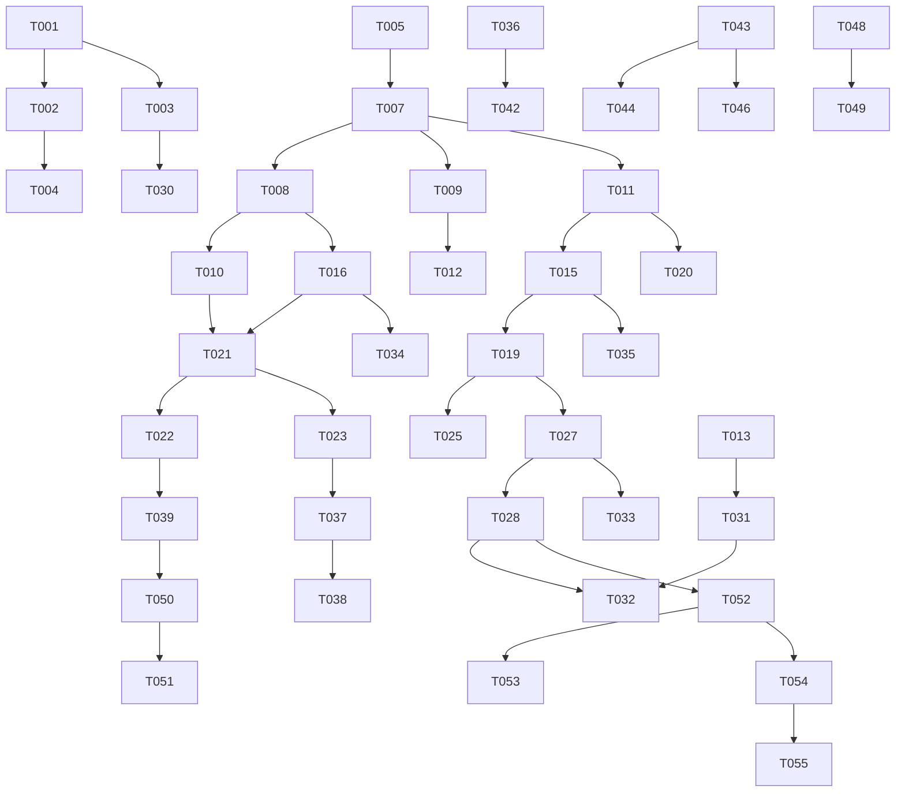

# 03 Implementation Plan

> Project name: **RunesHela** (selected, 2026-11-26)
> Status: to be frozen after decisions
> Progress: **M0 / M1 / M2 / M3 / M4 / M5 complete (2026-11-28)**
> Prerequisites: [01 PRD](./01-product-requirements.md) · [02 Technical Design](./02-technical-design.md) · [06 Decision Document](./06-decisions.md)
> Note: This breakdown **contains no code**; it only defines development tasks. All tasks enter execution only after the decisions are confirmed.

---

## 0. Global Definition of Done (DoD)

A task is "complete" only when all of the following hold:

1. **Implementation**: matches the corresponding section of the 02 technical design.
2. **Tests**: automated tests (programmatic) or explicit review records (human-judgement).
3. **Diagnostics**: new error paths have diagnostic codes/error codes and documentation links.
4. **Documentation**: public APIs have XML documentation; user-visible behavior has documentation or examples.
5. **Performance**: tasks touching the hot path must run benchmarks and record the results (no regression beyond budget).
6. **AOT**: tasks touching the runtime must pass in the AOT sample (0 warnings).
7. **Snapshots**: tasks affecting help/artifacts/generated code must update and review snapshots.
8. **No scope creep**: no features outside the PRD.

**Priority**: P0 = MVP blocker; P1 = V0.2~V1.0; P2 = V1.x.

---

## 1. M0 Feasibility Validation (prove before investing)

| ID | Task | P | Dependencies | Key deliverables | AC | Test requirements | Notes |
|---|---|---|---|---|---|---|---|
| T-001 | Generator minimal closed loop | P0 | — | `[Command]` class → generates a runnable empty entry point; verify analyzer packaging | AC-01 | P: template project compiles and runs | No parsing; only proves the "discovery → generation → packaging" chain |
| T-002 | Benchmark fixtures | P0 | T-001 | Four benchmark groups: 5 options/10 commands/help/errors; hardware and methodology document | AC-04/05 | P: BenchmarkDotNet produces JSON | Serves as the baseline for all subsequent performance comparisons |
| T-003 | AOT/Trim sample | P0 | T-001 | `PublishAot` sample; size/warnings/startup script | AC-13 | P: CI build + run | Covers win-x64/linux-x64/osx-arm64 |
| T-004 | Performance budget calibration | P0 | T-002/003 | Calibrate NFR-01~08 with real data | AC-04/05 | P: report | If unattainable, adjust the design rather than the targets |
| T-005 | Single-pass parsing prototype | P0 | — | `ReadOnlySpan` scanning + options/positional/`--` prototype | AC-02 | P: unit tests | No code generation; validate the algorithm first |
| T-006 | Competitor comparison | P1 | T-002 | Run SCL/CliFx/CAF on the same scenarios | AC-04 | P: comparison report | Used for "relative baseline" claims |

**M0 exit criteria**: T-001~T-005 complete; performance and AOT at least reach a "defensible" order of magnitude; otherwise return to design.

---

## 2. M1 Kernel: model, diagnostics, generation pipeline

| ID | Task | P | Dependencies | Key deliverables | AC | Test requirements | Notes |
|---|---|---|---|---|---|---|---|
| T-007 | Model IR | P0 | T-005 | `CommandModel`/`OptionModel`/`ParameterModel` + `EquatableArray` | AC-02/16 | P: equality/serialization tests | Holds no symbols |
| T-008 | Discovery and naming | P0 | T-007 | Class/nested/root command discovery; kebab-case; override rules | AC-01/02 | P: naming matrix | Conflicts deferred to T-012 |
| T-009 | Diagnostics framework | P0 | T-007 | `RHLxxx` code table, unified message format, documentation links | AC-16 | P: one failing sample per code | Codes are never reused |
| T-010 | Documentation comment parsing | P0 | T-008 | `
/<param>/<example>/<remarks>` | AC-01/19 | P: comment → help snapshot | Degrade gracefully when missing |
| T-011 | Type system | P0 | T-007 | Type matrix, `IParsable`/`ISpanParsable`, enum switch | AC-02 | P: type matrix tests | Unsupported type → RHL004 |
| T-012 | Semantic validation | P0 | T-008/009/011 | Duplicate names/required+default/positional order/params/reserved names | AC-16 | P: diagnostic snapshots | Errors skip that command |
| T-013 | Incremental pipeline | P0 | T-007 | Caching strategy, no `Compilation` capture, no-op benchmark | AC-06 | P: generator-driven benchmark | Target ≤30 ms per 50 commands |
| T-014 | Generation snapshot framework | P0 | T-001 | Verify snapshots of generated code/help/artifacts | AC-11 | P: snapshot CI | Changes require review |

**M1 exit criteria**: model stable; diagnostics complete; generator incremental; snapshots reviewable.

---

## 3. M2 Class-First MVP

| ID | Task | P | Dependencies | Key deliverables | AC | Test requirements | Notes |
|---|---|---|---|---|---|---|---|
| T-015 | Binding and construction | P0 | T-011 | Generated property assignment/constructor injection; pure POCO support | AC-01 | P: POCO without `partial` test | Core selling point |
| T-016 | Multi-level routing | P0 | T-008 | Nested switch; root command; default command | AC-02 | P: 3-level nesting | Case-sensitive |
| T-017 | Option syntax | P0 | T-005 | `--opt=value`/`--opt value`/short names/flags/negated flags | AC-02 | P: syntax matrix | Combined short options not supported |
| T-018 | Positional arguments and arrays | P0 | T-017 | Positional arguments/`params`/comma-separated arrays/repeated options | AC-02 | P: boundary tests | Negative numbers as values |
| T-019 | Defaults/required/ENV | P0 | T-015 | Precedence; missing-value errors; ENV reading | AC-01 | P: precedence matrix | Redaction see T-025 |
| T-020 | Validation attributes | P0 | T-011 | Generated checks for Required/Range/Regex/Length | AC-16 | P: validation snapshots | Zero reflection |
| T-021 | Human-readable help | P0 | T-010/016 | Usage/commands/parameters/options/examples/exit codes | AC-01/19 | P: 80/120-column snapshots + H: manual | CJK width |
| T-022 | JSON help | P0 | T-021 | Fixed schema; same source as human help | AC-09 | P: schema snapshots | `schemaVersion` |
| T-023 | Error model | P0 | T-009 | `RunesHelaError` + text/markdown/json rendering | AC-08/16 | P: error snapshots | No exceptions thrown on the normal path |
| T-024 | Entry point/template/quickstart | P0 | T-015/021 | `RunesHelaApp.RunAsync`, `dotnet new runeshela-cli`, 5-minute documentation | AC-01/03/20 | P: template build + H: newcomer walkthrough | Documentation examples go into CI |
| T-025 | Secret redaction | P0 | T-019 | Consistent across help/logs/errors/describe | AC-17 | P: leak scanning | Length truncation |
| T-026 | Color/TTY/CJK | P0 | T-021 | `NO_COLOR`/`TERM=dumb`/`--plain`/width | AC-18/19 | P: environment matrix | Windows VT |

**M2 exit criteria**: AC-01/02/09/13/16/17/18/19 pass; quickstart usable.

---

## 4. M3 Performance and Micro-Commands

| ID | Task | P | Dependencies | Key deliverables | AC | Test requirements | Notes |
|---|---|---|---|---|---|---|---|
| T-027 | Hot path optimization | P0 | T-017 | Span comparison, enum switch, no LINQ/regex | AC-04 | P: allocation assertions | 0 B target |
| T-028 | Zero-allocation validation | P0 | T-027 | `GC.GetAllocatedBytesForCurrentThread` assertions | AC-04 | P: benchmark + assertions | Excludes command instances |
| T-029 | Function pointers (optional) | P1 | T-027 | `RunesHelaAllowFunctionPointers` generates `delegate*` | AC-04 | P: benchmark comparison | unsafe switch |
| T-030 | AOT matrix | P0 | T-003 | 6 RIDs × AOT/Trim/single-file/R2R | AC-13 | P: CI matrix | 0 warnings |
| T-031 | Generator performance | P0 | T-013 | 1/10/50/200 command benchmarks | AC-06 | P: threshold gate | Fails above 50 ms |
| T-032 | CI performance gate | P0 | T-002/028/031 | Baseline JSON, comparison, 10% threshold, report | AC-14 | P: deliberate regression verification | Dedicated runner |
| T-033 | Method-first `RunesHela.Script` | P1 | T-027 | Call-site analysis, separate entry point, simple types | AC-01/04 | P: script-mode sample | Complex DI not supported |
| T-034 | Filter chain | P0 | T-016 | Static chain, ordering, exceptions/timing | AC-08 | P: ordering/exception tests | 1 allocation per filter |
| T-035 | DI adaptation | P0 | T-015 | `IServiceProvider` resolution + missing-dependency errors | AC-01 | P: with/without container | No built-in container |

**M3 exit criteria**: AC-04/05/06/13/14 pass; method-first usable (if D-04=C).

---

## 5. M4 Agent Contract

| ID | Task | P | Dependencies | Key deliverables | AC | Test requirements | Notes |
|---|---|---|---|---|---|---|---|
| T-036 | Automatic non-TTY mode | P0 | T-023/026 | No color/no spinner/format selection | AC-07 | P: pseudo-terminal matrix | Can be overridden explicitly |
| T-037 | Structured error enhancement | P0 | T-023 | `code/hint/nextSteps/docsUrl`; did-you-mean | AC-08 | P: snapshots + H: readability | Candidate sets precomputed |
| T-038 | Destructive guard | P0 | T-037 | `[Destructive]` + `--yes` + `--no-input` | AC-08 | P: timeout tests | Non-TTY must fail fast |
| T-039 | Self-description | P0 | T-022 | `describe`/`schema` full model | AC-10 | P: consistency tests | Same source as help |
| T-040 | Exit code matrix | P0 | T-023 | 0/1/2/3/4/5/6/7/130 | AC-08 | P: process-level tests | Documented |
| T-041 | Output channels/EPIPE | P0 | T-036 | stdout for pure data; stderr for diagnostics; broken pipe handling | AC-07 | P: pipeline tests | Exit code 141 convention |
| T-042 | Agent contract suite | P0 | T-036~041 | Pseudo-terminal + non-interactive + JSON assertions | AC-07/08/10 | P: CI suite | Regression prevention |

**M4 exit criteria**: AC-07/08/09/10 pass; the "Agent succeeds on the first try" demo is usable.

---

## 6. M5 Artifacts: Completion, Man Pages, Docs

| ID | Task | P | Dependencies | Key deliverables | AC | Test requirements | Notes |
|---|---|---|---|---|---|---|---|
| T-043 | Static completion | P1 | T-016 | bash/zsh/fish/pwsh scripts | AC-12 | P: four-shell smoke test | Escaping |
| T-044 | Dynamic completion | P2 | T-043 | `__complete` protocol | AC-12 | P: candidates/timeout | Hidden command |
| T-045 | Man/Docs | P2 | T-021 | roff + Markdown | AC-11 | P: `man -l` + rendering | Same source |
| T-046 | Artifact consistency | P0 | T-043/045 | help/completion/schema/docs comparison | AC-11 | P: set comparison | Drift prevention |

**M5 exit criteria**: AC-11/12 pass; zero artifact drift.

---

## 7. M6 Configuration (V1.0)

| ID | Task | P | Dependencies | Key deliverables | AC | Test requirements | Notes |
|---|---|---|---|---|---|---|---|
| T-047 | ENV binding completion | P1 | T-019 | Prefix/type conversion/precedence | AC-01 | P: matrix | Partly done in T-019 |
| T-048 | JSON configuration | P1 | T-047 | `JsonDocument` parsing, key paths, schema | AC-09 | P: precedence/errors | No reflection |
| T-049 | Configuration errors/redaction | P1 | T-048 | Exit code 3; permission checks; redaction | AC-17 | P: security tests | Unix permissions |

**M6 exit criteria**: configuration precedence/errors/redaction all pass; schema matches the model.

---

## 8. M7 MCP (V1.x, optional)

| ID | Task | P | Dependencies | Key deliverables | AC | Test requirements | Notes |
|---|---|---|---|---|---|---|---|
| T-050 | MCP Manifest | P2 | T-039 | `mcp --manifest` tool listing | AC-11 | P: schema consistency | Read-only/destructive annotations |
| T-051 | stdio server | P2 | T-050 | JSON-RPC, cancellation, error mapping | AC-08 | P: end-to-end | Optional package |

**M7 exit criteria**: manifest consistent with the CLI; the server can be invoked by MCP clients.

---

## 9. M8 Release and Community

| ID | Task | P | Dependencies | Key deliverables | AC | Test requirements | Notes |
|---|---|---|---|---|---|---|---|
| T-052 | Versioning/compatibility/packaging | P0 | All | SemVer, ApiCompat, symbol packages, SourceLink, LICENSE/NOTICE (Apache-2.0) | AC-15 | P: compatibility gate + license check | Baseline package |
| T-053 | Documentation site/benchmark reports/migration | P1 | T-052 | Quickstart, reference, comparison, migration guide | AC-03/20 | P: link checking + H: review | English first, Chinese on demand (D-10=B) |
| T-054 | Security/governance | P0 | T-052 | SBOM, signing, OIDC, SECURITY, CODEOWNERS, DCO | AC-17 | P: supply chain checks | 2FA/branch protection |
| T-055 | Release rehearsal | P0 | T-052 | Pre-release → general availability; rollback plan | — | P: dry-run | Version numbers/changelog |

---

## 10. Dependency DAG (Overview)

> Note: The DAG is an overview view; authoritative dependencies are the "Dependencies" column of each task table. Edges not drawn indicate weak dependencies or parallelizable work.

---

## 11. Acceptance Criteria → Task Traceability Matrix

| AC | Covered tasks | Notes |
|---|---|---|
| AC-01 | T-001, T-008, T-015, T-019, T-024, T-035 | Class-first minimal closed loop |
| AC-02 | T-005, T-007, T-008, T-011, T-016, T-017, T-018 | Routing/syntax/types |
| AC-03 | T-024, T-053 | Quickstart manual walkthrough |
| AC-04 | T-002, T-006, T-027, T-028, T-029, T-033 | Microbenchmarks |
| AC-05 | T-003, T-004, T-030 | AOT startup/size |
| AC-06 | T-013, T-031 | Incremental build |
| AC-07 | T-036, T-041, T-042 | Output contract |
| AC-08 | T-023, T-034, T-037, T-038, T-040, T-042, T-051 | Errors/guards/exit codes |
| AC-09 | T-022, T-039, T-048 | Machine-readable help/configuration |
| AC-10 | T-039 | describe |
| AC-11 | T-014, T-045, T-046, T-050 | Artifact consistency |
| AC-12 | T-043, T-044 | Completion |
| AC-13 | T-003, T-030 | AOT matrix |
| AC-14 | T-032 | Performance gate |
| AC-15 | T-052 | API compatibility |
| AC-16 | T-009, T-012, T-020 | Diagnostics/validation |
| AC-17 | T-025, T-049, T-054 | Redaction/security |
| AC-18 | T-026 | NO_COLOR |
| AC-19 | T-021, T-026 | CJK/width |
| AC-20 | T-024, T-053 | First screen/documentation |

**Check**: every AC has at least one task; every P0 task maps to at least one AC or has an explicit quality goal (T-052~055).

---

## 12. Recommended Initial Execution Order (After Decisions)

1. **T-001 → T-002 → T-003 → T-004**: prove feasibility first and obtain real data.
2. **T-005 → T-007 → T-008/T-009/T-011**: kernel model and parsing.
3. **T-015 → T-016/T-017/T-018/T-019 → T-021/T-023 → T-024**: drive the MVP end to end.
4. **T-027/T-028 → T-030/T-032**: performance and AOT gates.
5. **T-036~T-042**: Agent contract.
6. The remainder proceeds by version.

---

## 13. Task Risk Notes

| Task | Risk | Mitigation |
|---|---|---|
| T-013 Incremental pipeline | Cache invalidation causes IDE stalls | Equality tests + generator benchmarks |
| T-015 Pure POCO binding | `init`/`required`/accessibility boundaries | Early prototype + diagnostics |
| T-021 Help rendering | CJK/width/color across platforms | Snapshots + multi-terminal testing |
| T-027 Zero allocation | Language/runtime limitations | Tiered budgets; drop individual paths if necessary |
| T-033 Method-first | Complex call-site analysis | Narrow first, then broaden; diagnose unsupported shapes |
| T-038 Destructive guard | Accidentally harming human users | TTY branch + confirmation flow |
| T-048 Configuration | Complex precedence/redaction | JSON first; schema first |
| T-050 MCP | Specification evolution | Adaptation layer + optional package |
