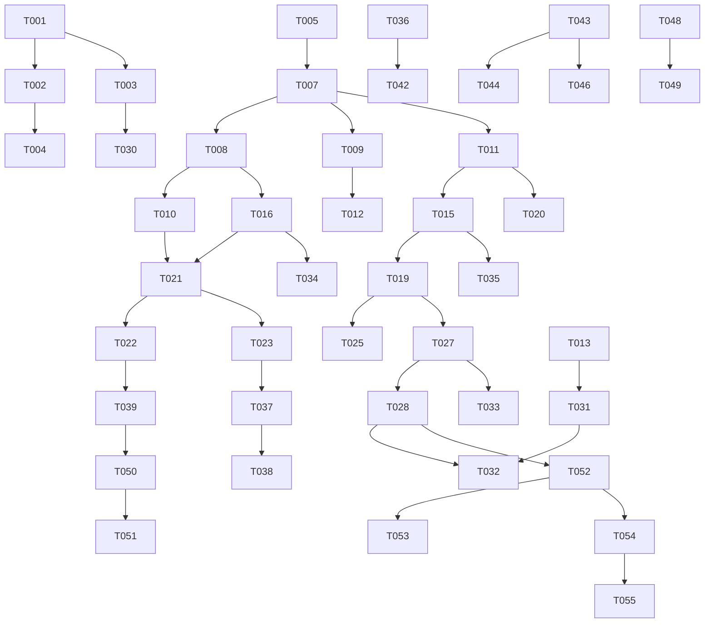

# 03 实现任务分解

> 项目名称：**RunesHela**（已选定，2026-11-26）
> 状态：待决策后冻结
> 进度：**M0 / M1 / M2 / M3 已完成（2026-11-27）**
> 前置：[01 PRD](./01-产品需求文档-PRD.md) · [02 技术设计](./02-技术设计文档.md) · [06 决策文档](./06-决策记录.md)
> 说明：本分解**不包含任何代码**，仅定义开发任务。所有任务在决策确认后才进入执行。

---

## 0. 全局完成定义（DoD）

一个任务“完成”必须同时满足：

1. **实现**：符合 02 技术设计的对应章节。
2. **测试**：有自动化测试（programmatic）或明确的评审记录（human-judgement）。
3. **诊断**：新增错误路径有诊断码/错误码与文档链接。
4. **文档**：公共 API 有 XML 文档；用户可见行为有文档或示例。
5. **性能**：触及热路径的任务必须跑基准并记录（不得回退超预算）。
6. **AOT**：触及运行时的任务必须在 AOT 样例中通过（0 警告）。
7. **快照**：影响帮助/产物/生成代码的任务必须更新并评审快照。
8. **无范围蔓延**：不引入未在 PRD 中的功能。

**优先级**：P0 = MVP 阻塞；P1 = V0.2~V1.0；P2 = V1.x。

---

## 1. M0 可行性验证（先证明再投入）

| ID | 任务 | P | 依赖 | 关键交付 | AC | 测试要求 | 备注 |
|---|---|---|---|---|---|---|---|
| T-001 | 生成器最小闭环 | P0 | — | `[Command]` 类 → 生成可运行的空入口；验证 analyzer 打包 | AC-01 | P：模板项目编译运行 | 不含解析；只证明“发现→生成→打包”链路 |
| T-002 | 基准夹具 | P0 | T-001 | 5 选项/10 命令/帮助/错误四组基准；硬件与方法文档 | AC-04/05 | P：BenchmarkDotNet 产出 JSON | 作为后续所有性能比较的基线 |
| T-003 | AOT/Trim 样例 | P0 | T-001 | `PublishAot` 样例；体积/警告/启动脚本 | AC-13 | P：CI 构建 + 运行 | 覆盖 win-x64/linux-x64/osx-arm64 |
| T-004 | 性能预算校准 | P0 | T-002/003 | 用真实数据校准 NFR-01~08 | AC-04/05 | P：报告 | 若达不到，调整设计而非改目标 |
| T-005 | 单遍解析原型 | P0 | — | `ReadOnlySpan` 扫描 + 选项/位置/`--` 原型 | AC-02 | P：单元测试 | 不生成代码，先验证算法 |
| T-006 | 竞品对照 | P1 | T-002 | 同场景跑 SCL/CliFx/CAF | AC-04 | P：对照报告 | 用于“相对基线”声明 |

**M0 退出条件**：T-001~T-005 完成；性能与 AOT 至少达到“可辩护”的量级；否则回到设计。

---

## 2. M1 内核：模型、诊断、生成管道

| ID | 任务 | P | 依赖 | 关键交付 | AC | 测试要求 | 备注 |
|---|---|---|---|---|---|---|---|
| T-007 | 模型 IR | P0 | T-005 | `CommandModel`/`OptionModel`/`ParameterModel` + `EquatableArray` | AC-02/16 | P：相等性/序列化测试 | 不持有 symbol |
| T-008 | 发现与命名 | P0 | T-007 | 类/嵌套/根命令发现；kebab-case；覆盖规则 | AC-01/02 | P：命名矩阵 | 冲突留给 T-012 |
| T-009 | 诊断框架 | P0 | T-007 | `RHLxxx` 码表、统一消息格式、文档链接 | AC-16 | P：每个码一个失败样例 | 码不复用 |
| T-010 | 文档注释解析 | P0 | T-008 | `
/<param>/<example>/<remarks>` | AC-01/19 | P：注释→帮助快照 | 缺失降级 |
| T-011 | 类型系统 | P0 | T-007 | 类型矩阵、`IParsable`/`ISpanParsable`、枚举 switch | AC-02 | P：类型矩阵测试 | 不支持类型 → RHL004 |
| T-012 | 语义校验 | P0 | T-008/009/011 | 重名/必填+默认/位置顺序/params/保留名 | AC-16 | P：诊断快照 | 错误跳过该命令 |
| T-013 | 增量管道 | P0 | T-007 | 缓存策略、无 `Compilation` 捕获、no-op 基准 | AC-06 | P：生成器驱动基准 | 目标 ≤30ms/50 命令 |
| T-014 | 生成快照框架 | P0 | T-001 | 生成代码/帮助/产物的 Verify 快照 | AC-11 | P：快照 CI | 变更需评审 |

**M1 退出条件**：模型稳定；诊断完整；生成器可增量；快照可评审。

---

## 3. M2 类优先 MVP

| ID | 任务 | P | 依赖 | 关键交付 | AC | 测试要求 | 备注 |
|---|---|---|---|---|---|---|---|
| T-015 | 绑定与构造 | P0 | T-011 | 生成的属性赋值/构造注入；纯 POCO 支持 | AC-01 | P：POCO 无 `partial` 测试 | 核心卖点 |
| T-016 | 多级路由 | P0 | T-008 | 嵌套 switch；根命令；默认命令 | AC-02 | P：3 层嵌套 | 大小写敏感 |
| T-017 | 选项语法 | P0 | T-005 | `--opt=value`/`--opt value`/短名/旗标/否定旗标 | AC-02 | P：语法矩阵 | 不支持合并短选项 |
| T-018 | 位置与数组 | P0 | T-017 | 位置参数/`params`/逗号数组/重复选项 | AC-02 | P：边界测试 | 负数作为值 |
| T-019 | 默认/必填/ENV | P0 | T-015 | 优先级；缺失错误；ENV 读取 | AC-01 | P：优先级矩阵 | 脱敏见 T-025 |
| T-020 | 验证特性 | P0 | T-011 | Required/Range/Regex/Length 生成检查 | AC-16 | P：校验快照 | 零反射 |
| T-021 | 人类帮助 | P0 | T-010/016 | Usage/命令/参数/选项/示例/退出码 | AC-01/19 | P：80/120 列快照 + H：人工 | CJK 宽度 |
| T-022 | JSON 帮助 | P0 | T-021 | 固定 Schema；与人类帮助同源 | AC-09 | P：Schema 快照 | `schemaVersion` |
| T-023 | 错误模型 | P0 | T-009 | `RunesHelaError` + text/markdown/json 渲染 | AC-08/16 | P：错误快照 | 正常路径不抛异常 |
| T-024 | 入口/模板/Quickstart | P0 | T-015/021 | `RunesHelaApp.RunAsync`、`dotnet new runeshela-cli`、5 分钟文档 | AC-01/03/20 | P：模板构建 + H：新人演练 | 文档示例进 CI |
| T-025 | Secret 脱敏 | P0 | T-019 | 帮助/日志/错误/describe 一致 | AC-17 | P：泄漏扫描 | 长度截断 |
| T-026 | 颜色/TTY/CJK | P0 | T-021 | `NO_COLOR`/`TERM=dumb`/`--plain`/宽度 | AC-18/19 | P：环境矩阵 | Windows VT |

**M2 退出条件**：AC-01/02/09/13/16/17/18/19 通过；Quickstart 可用。

---

## 4. M3 性能与微命令

| ID | 任务 | P | 依赖 | 关键交付 | AC | 测试要求 | 备注 |
|---|---|---|---|---|---|---|---|
| T-027 | 热路径优化 | P0 | T-017 | span 比较、枚举 switch、无 LINQ/正则 | AC-04 | P：分配断言 | 0 B 目标 |
| T-028 | 零分配验证 | P0 | T-027 | `GC.GetAllocatedBytesForCurrentThread` 断言 | AC-04 | P：基准 + 断言 | 不含命令实例 |
| T-029 | 函数指针（可选） | P1 | T-027 | `RunesHelaAllowFunctionPointers` 生成 `delegate*` | AC-04 | P：基准对比 | unsafe 开关 |
| T-030 | AOT 矩阵 | P0 | T-003 | 6 RID × AOT/Trim/Single-file/R2R | AC-13 | P：CI 矩阵 | 0 警告 |
| T-031 | 生成器性能 | P0 | T-013 | 1/10/50/200 命令基准 | AC-06 | P：阈值门禁 | 超 50ms 失败 |
| T-032 | CI 性能门禁 | P0 | T-002/028/031 | 基线 JSON、对比、10% 阈值、报告 | AC-14 | P：故意回退验证 | 专用 runner |
| T-033 | 方法优先 `RunesHela.Script` | P1 | T-027 | 调用点分析、独立入口、简单类型 | AC-01/04 | P：脚本模式样例 | 不支持复杂 DI |
| T-034 | 过滤器链 | P0 | T-016 | 静态链、顺序、异常/计时 | AC-08 | P：顺序/异常测试 | 每过滤器 1 分配 |
| T-035 | DI 适配 | P0 | T-015 | `IServiceProvider` 解析 + 缺失错误 | AC-01 | P：有/无容器 | 不内置容器 |

**M3 退出条件**：AC-04/05/06/13/14 通过；方法优先可用（若 D-04=C）。

---

## 5. M4 Agent 契约

| ID | 任务 | P | 依赖 | 关键交付 | AC | 测试要求 | 备注 |
|---|---|---|---|---|---|---|---|
| T-036 | 非 TTY 自动模式 | P0 | T-023/026 | 去色/去 spinner/格式选择 | AC-07 | P：伪终端矩阵 | 可显式覆盖 |
| T-037 | 结构化错误增强 | P0 | T-023 | `code/hint/nextSteps/docsUrl`；did-you-mean | AC-08 | P：快照 + H：可读性 | 候选集预计算 |
| T-038 | 破坏性守卫 | P0 | T-037 | `[Destructive]` + `--yes` + `--no-input` | AC-08 | P：超时测试 | 非 TTY 必须快速失败 |
| T-039 | 自描述 | P0 | T-022 | `describe`/`schema` 全量模型 | AC-10 | P：一致性测试 | 与帮助同源 |
| T-040 | 退出码矩阵 | P0 | T-023 | 0/1/2/3/4/5/6/7/130 | AC-08 | P：进程级测试 | 文档化 |
| T-041 | 输出通道/EPIPE | P0 | T-036 | stdout 纯数据；stderr 诊断；断管处理 | AC-07 | P：管道测试 | 退出码 141 约定 |
| T-042 | Agent 契约套件 | P0 | T-036~041 | 伪终端 + 非交互 + JSON 断言 | AC-07/08/10 | P：CI 套件 | 防回归 |

**M4 退出条件**：AC-07/08/09/10 通过；“Agent 一次成功”演示可用。

---

## 6. M5 产物：补全、Man、文档

| ID | 任务 | P | 依赖 | 关键交付 | AC | 测试要求 | 备注 |
|---|---|---|---|---|---|---|---|
| T-043 | 静态补全 | P1 | T-016 | bash/zsh/fish/pwsh 脚本 | AC-12 | P：四 shell 冒烟 | 转义 |
| T-044 | 动态补全 | P2 | T-043 | `__complete` 协议 | AC-12 | P：候选/超时 | 隐藏命令 |
| T-045 | Man/Docs | P2 | T-021 | roff + Markdown | AC-11 | P：`man -l` + 渲染 | 同源 |
| T-046 | 产物一致性 | P0 | T-043/045 | help/completion/schema/docs 对比 | AC-11 | P：集合比对 | 防漂移 |

**M5 退出条件**：AC-11/12 通过；产物零漂移。

---

## 7. M6 配置（V1.0）

| ID | 任务 | P | 依赖 | 关键交付 | AC | 测试要求 | 备注 |
|---|---|---|---|---|---|---|---|
| T-047 | ENV 绑定完善 | P1 | T-019 | 前缀/类型转换/优先级 | AC-01 | P：矩阵 | 已部分在 T-019 |
| T-048 | JSON 配置 | P1 | T-047 | `JsonDocument` 解析、键路径、Schema | AC-09 | P：优先级/错误 | 无反射 |
| T-049 | 配置错误/脱敏 | P1 | T-048 | 退出码 3；权限检查；脱敏 | AC-17 | P：安全测试 | Unix 权限 |

**M6 退出条件**：配置优先级/错误/脱敏全部通过；Schema 与模型一致。

---

## 8. M7 MCP（V1.x，可选）

| ID | 任务 | P | 依赖 | 关键交付 | AC | 测试要求 | 备注 |
|---|---|---|---|---|---|---|---|
| T-050 | MCP Manifest | P2 | T-039 | `mcp --manifest` 工具清单 | AC-11 | P：Schema 一致性 | 只读/破坏性注解 |
| T-051 | stdio server | P2 | T-050 | JSON-RPC、取消、错误映射 | AC-08 | P：端到端 | 可选包 |

**M7 退出条件**：Manifest 与 CLI 一致；server 可被 MCP 客户端调用。

---

## 9. M8 发布与社区

| ID | 任务 | P | 依赖 | 关键交付 | AC | 测试要求 | 备注 |
|---|---|---|---|---|---|---|---|
| T-052 | 版本/兼容/打包 | P0 | 全部 | SemVer、ApiCompat、符号包、SourceLink、LICENSE/NOTICE（Apache-2.0） | AC-15 | P：兼容门禁 + 许可证检查 | 基线包 |
| T-053 | 文档站/基准报告/迁移 | P1 | T-052 | Quickstart、参考、对比、迁移指南 | AC-03/20 | P：链接检查 + H：评审 | 英文优先，中文按需（D-10=B） |
| T-054 | 安全/治理 | P0 | T-052 | SBOM、签名、OIDC、SECURITY、CODEOWNERS、DCO | AC-17 | P：供应链检查 | 2FA/分支保护 |
| T-055 | 发布演练 | P0 | T-052 | 预发布 → 正式；回滚方案 | — | P：dry-run | 版本号/变更日志 |

---

## 10. 依赖 DAG（概要）

> 说明：DAG 为概要视图；完整依赖以各任务表“依赖”列为准。未画出的边表示弱依赖/可并行。

---

## 11. 验收标准 → 任务追溯矩阵

| AC | 覆盖任务 | 说明 |
|---|---|---|
| AC-01 | T-001、T-008、T-015、T-019、T-024、T-035 | 类优先最小闭环 |
| AC-02 | T-005、T-007、T-008、T-011、T-016、T-017、T-018 | 路由/语法/类型 |
| AC-03 | T-024、T-053 | Quickstart 人工演练 |
| AC-04 | T-002、T-006、T-027、T-028、T-029、T-033 | 微基准 |
| AC-05 | T-003、T-004、T-030 | AOT 启动/体积 |
| AC-06 | T-013、T-031 | 增量构建 |
| AC-07 | T-036、T-041、T-042 | 输出契约 |
| AC-08 | T-023、T-034、T-037、T-038、T-040、T-042、T-051 | 错误/守卫/退出码 |
| AC-09 | T-022、T-039、T-048 | 机器可读帮助/配置 |
| AC-10 | T-039 | describe |
| AC-11 | T-014、T-045、T-046、T-050 | 产物一致性 |
| AC-12 | T-043、T-044 | 补全 |
| AC-13 | T-003、T-030 | AOT 矩阵 |
| AC-14 | T-032 | 性能门禁 |
| AC-15 | T-052 | API 兼容 |
| AC-16 | T-009、T-012、T-020 | 诊断/校验 |
| AC-17 | T-025、T-049、T-054 | 脱敏/安全 |
| AC-18 | T-026 | NO_COLOR |
| AC-19 | T-021、T-026 | CJK/宽度 |
| AC-20 | T-024、T-053 | 首屏/文档 |

**检查**：每个 AC 至少有一个任务；每个 P0 任务至少映射一个 AC 或有明确质量目标（T-052~055）。

---

## 12. 首批建议执行顺序（决策后）

1. **T-001 → T-002 → T-003 → T-004**：先证明可行性，拿到真实数据。
2. **T-005 → T-007 → T-008/T-009/T-011**：内核模型与解析。
3. **T-015 → T-016/T-017/T-018/T-019 → T-021/T-023 → T-024**：打通 MVP 端到端。
4. **T-027/T-028 → T-030/T-032**：性能与 AOT 门禁。
5. **T-036~T-042**：Agent 契约。
6. 其余按版本推进。

---

## 13. 任务风险提示

| 任务 | 风险 | 缓解 |
|---|---|---|
| T-013 增量管道 | 缓存失效导致 IDE 卡顿 | 相等性测试 + 生成器基准 |
| T-015 纯 POCO 绑定 | `init`/`required`/访问性边界 | 早期原型 + 诊断 |
| T-021 帮助渲染 | CJK/宽度/颜色跨平台 | 快照 + 多终端测试 |
| T-027 零分配 | 语言/运行时限制 | 预算分级；必要时放弃个别路径 |
| T-033 方法优先 | 调用点分析复杂 | 先窄后宽；诊断不支持形态 |
| T-038 破坏性守卫 | 误伤人类用户 | TTY 分支 + 确认流程 |
| T-048 配置 | 优先级/脱敏复杂 | 先 JSON；Schema 先行 |
| T-050 MCP | 规范演进 | 适配层 + 可选包 |
